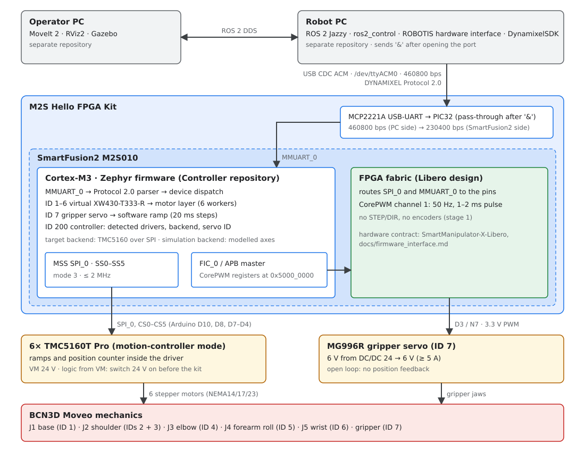

# System Architecture

## Project objective

The target is to use the ROS 2 control and operator-software concepts of ROBOTIS [OpenMANIPULATOR-X](https://docs.robotis.com/docs/systems/openmanipulator_x/overview/) with the mechanical design of [BCN3D Moveo](https://github.com/BCN3D/BCN3D-Moveo). A Microchip SmartFusion2 (M2S Hello FPGA Kit) replaces the DYNAMIXEL actuators: it drives stepper motors on the Moveo mechanism and a hobby servo on the gripper, and presents them to the host as virtual DYNAMIXEL devices.

These sources have different roles. OpenMANIPULATOR-X is the reference for the ROS/DYNAMIXEL software stack; BCN3D Moveo is the mechanical reference. The OpenMANIPULATOR-X robot geometry, joints, actuator assumptions, and hardware configuration must not be copied as if they described Moveo.

## System context



The SmartFusion2 is a motor controller implementing device behavior; it is not merely a USB-to-DYNAMIXEL converter. Details of each link:

| Link | Implementation | Reference |
| --- | --- | --- |
| Robot PC ↔ kit | USB Mini-B → MCP2221A (CDC ACM) → PIC32 → MMUART_0. PC side 460800 bps, firmware side 230400 bps; the PIC32 forwards only after the host has sent `&` | [Host link](../hardware/wiring.md#host-link-usb-pic32-smartfusion2) |
| Firmware ↔ stepper drivers | MSS SPI_0, routed through the fabric to the Arduino header, six chip selects; TMC5160 in motion-controller mode (no STEP/DIR) | [Hello FPGA Kit wiring](../hardware/wiring.md), [TMC5160 driver modules](../hardware/tmc5160.md) |
| Firmware ↔ gripper servo | CorePWM channel 1 in the fabric, APB registers at `0x5000_0000`, output on D3 (N7) | [Gripper servo (MG996R)](../hardware/servo.md) |
| Power | 24 V PSU for the TMC5160 modules (VM), DC/DC 24 → 6 V for the servo, kit from USB; one GND star point at the PSU minus | [Power and servo](../hardware/wiring.md#power-and-servo) |

## ARM and FPGA partition

As built (Libero stage 2, firmware on `main`):

| Function | Where | Status |
| --- | --- | --- |
| Host link, Protocol 2.0, Control Tables, unit conversion | Cortex-M3 (Zephyr) | Implemented; host link verified on the kit |
| Axis control: ramps, position counter, current | TMC5160 (motion-controller mode), configured over SPI by the Cortex-M3 | Implemented; detection, registers and ramp generator verified on one module (A0); the shaft does not turn yet, the module is in STEP/DIR mode (`SD_MODE=1`) |
| Gripper servo ramp (20 ms steps) | Cortex-M3 (`k_timer`) | Implemented; works on the kit |
| Gripper servo pulse generation | FPGA fabric (CorePWM) | In the Libero design; the servo follows Goal Position on the kit (travel not calibrated) |
| Pin routing of SPI_0 and MMUART_0 | FPGA fabric | Verified on the kit |
| STEP/DIR generation, encoders, high-rate loops | – | Not used: the drivers generate the ramps; no encoders in stage 1 |

## Component ownership

| Component | Responsibility | Repository boundary |
| --- | --- | --- |
| SmartFusion2 firmware | DYNAMIXEL Protocol 2.0 device behavior, Control Tables, TMC5160 configuration and commands, gripper servo | **This repository** (`apps/SmartManipulator_Controller`), plus the host motor tester (`tools/dxl_test_gui`) |
| SmartFusion2 FPGA design | Pin routing, CorePWM, clocks; the hardware contract for the firmware | Separate Libero repository (`SmartManipulator-X-Libero`, `docs/firmware_interface.md`) |
| Robot PC | ROS 2 Jazzy, `ros2_control`, verified ROBOTIS hardware path, USB access, robot bringup | Separate Robot PC repository |
| Operator PC | MoveIt 2, RViz2, Gazebo, operator workflows, ROS 2 DDS client | Separate Operator PC repository |
| BCN3D Moveo | Mechanical links, joints, printed parts, assembly and mechanical limits | Upstream mechanical source; project model integration belongs in the Robot PC repository or a shared description repository |
| ROBOTIS packages | Reusable SDK, hardware interface, messages, and upstream OpenMANIPULATOR software | Separate upstream checkouts managed by the Robot PC manifests |

The pages under *System context* are shared with the Robot PC repository. When this page changes, update the copy there as well.

## Software reuse boundary

The physical control path is:

```text
MoveIt 2
  -> ros2_control
  -> ROBOTIS dynamixel_hardware_interface
  -> DynamixelSDK
  -> USB (MCP2221A, /dev/ttyACM0) -> PIC32 -> MMUART_0
  -> SmartFusion2 virtual DYNAMIXEL devices (IDs 1-6 axes, ID 7 gripper)
  -> TMC5160 over SPI -> stepper motors
  -> CorePWM -> gripper servo
```

Reuse the existing ROBOTIS hardware interface if source analysis confirms that its model configuration, protocol operations, control-table accesses, command/state interfaces, and timing requirements can be supported. Do not add a project-specific `smartfusion2_hardware_interface` pre-emptively. Implement only the device behavior needed by the verified host stack, not a presumed complete XM430 clone. Two host requirements come from the kit, not from DYNAMIXEL: the host must send `&` once after opening the port, and a `0x00` after any packet that ends with `0x25` (see [Host link](../hardware/wiring.md#host-link-usb-pic32-smartfusion2)).

The devices report project model numbers where they differ from a real DYNAMIXEL: the axes report XW430-T333-R (1270), the gripper servo `0x5356`, the controller `0x5358`. Whether the ROBOTIS stack accepts these must be checked before it is configured (see the [compatibility specification](../dynamixel/compatibility-spec.md)).

Reusing the OpenMANIPULATOR-X ROS application does not make its robot model or joint/controller configuration valid for Moveo. MoveIt planning groups, joint names, limits, kinematics, transmission assumptions, ros2_control interfaces, and controller configuration must agree with a verified Moveo description and the physical stepper setup.

The Robot PC image is intentionally separate from the Operator PC runtime. MoveIt, RViz2, and Gazebo do not belong in the Robot PC image. In simulation, route `ros2_control` to the selected Gazebo integration; on the real robot, route it to the DYNAMIXEL/SmartFusion2 path. Keep the robot model and joint semantics consistent across both modes.

## Operating assumptions

- The Robot PC target is Ubuntu 24.04 with ROS 2 Jazzy; the Robot PC profile uses Docker.
- The Operator PC runs ROS 2 Jazzy and reaches the Robot PC using DDS over the configured network.
- The kit enumerates through its MCP2221A as a USB CDC ACM device, commonly `/dev/ttyACM0`. Only the Robot PC owns this connection; the Operator PC does not require direct USB access.
- DDS domain ID, interface selection, discovery, and firewall policy must be configured consistently across hosts. SSH is for administration, not the ROS data path.
- Positioning is open loop: no encoders, no limit switches, no homing. The arm is placed in the start pose by hand before power-up; the servo position is unknown until the first command.
- Power-up order: 24 V (TMC5160 logic runs from VM) and the servo DC/DC before the kit.

## Verified state versus target

| Area | Current state | Target or open verification |
| --- | --- | --- |
| SmartFusion2 firmware | Implemented in this repository: 6 axes, gripper servo, controller device. Passes `firmware_check.py` 49/49 on `native_sim`. On the kit: host link, TMC5160 detection, register mapping and ramp generator on A0, and the gripper servo work | Motion of the axes (A0 module in STEP/DIR mode, `SD_MODE=1`); servo travel calibration; gear ratios, joint limits |
| FPGA design | Libero stage 2: pin routing and CorePWM; the CorePWM output drives the servo on the kit | Pulse widths not measured with an oscilloscope yet |
| Robot description | Not in this repository | Import/author the BCN3D Moveo model; verify frame, joint, limit, and visual/collision data |
| Robot PC | Separate repository | Verify upstream Jazzy sources against the device behavior (model numbers, registers, `&` and `0x25` handling) |
| Operator PC | Separate repository | Consume the canonical Moveo description and validate DDS |
| Mechanical/electrical integration | Wiring Rev. D (draft): six TMC5160T Pro, MG996R gripper servo, 24 V and 6 V supplies | Joint-to-motor mapping on the real arm, shoulder pairing (IDs 2 and 3), limits, safety (emergency stop) |

## Upstream references

- [ROBOTIS OpenMANIPULATOR-X overview](https://docs.robotis.com/docs/systems/openmanipulator_x/overview/)
- [BCN3D Moveo source repository](https://github.com/BCN3D/BCN3D-Moveo)
- [ROBOTIS OpenMANIPULATOR ROS 2 source](https://github.com/ROBOTIS-GIT/open_manipulator)
- [DynamixelSDK source](https://github.com/ROBOTIS-GIT/DynamixelSDK)
- [DYNAMIXEL hardware interface source](https://github.com/ROBOTIS-GIT/dynamixel_hardware_interface)
