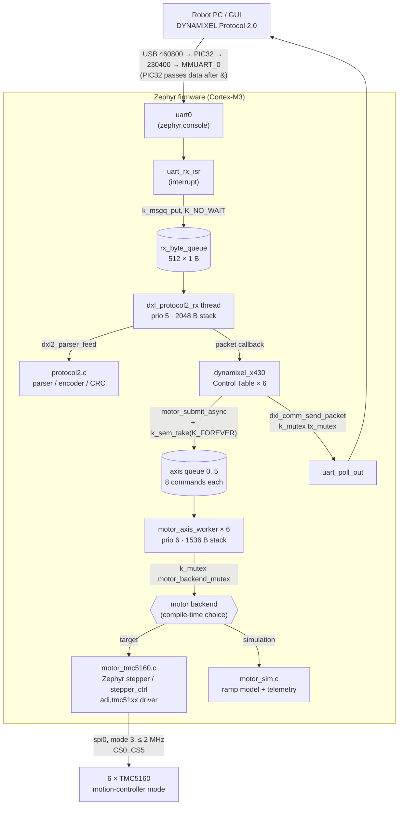
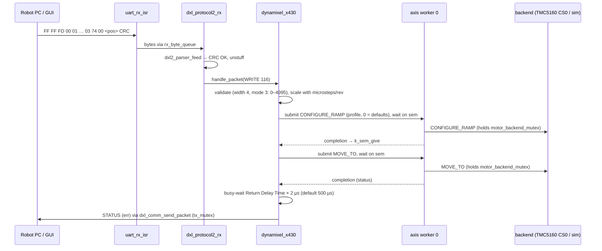

# Firmware architecture

The application in `apps/SmartManipulator_Controller` turns the SmartFusion2
Cortex-M3 into six virtual DYNAMIXEL XW430-T333-R devices. Protocol 2.0 packets
from the Robot PC arrive on the host UART. They are decoded and applied to a
per-axis Control Table model, then executed by a **motor backend**: either six
TMC5160 drivers on SPI (target firmware) or a simulated axis model (simulation
firmware).

## Firmware variants

| | Target firmware | Simulation firmware |
| --- | --- | --- |
| Purpose | Drive the robot arm | Verify the DYNAMIXEL protocol implementation on the board, without motors |
| Build | `west build -b m2s_hello_fpga_kit/m2s010 -s apps/SmartManipulator_Controller -d build` | same command with `-d build-sim -- -DFILE_SUFFIX=sim` |
| VS Code (Linux menu) | **Build firmware** / **Clean and Build** | **Build simulation firmware** / **Clean and Build simulation firmware** |
| Kconfig / overlay | `prj.conf`, `boards/m2s_hello_fpga_kit_m2s010.overlay` (6× `adi,tmc51xx`) | `prj_sim.conf`, `boards/m2s_hello_fpga_kit_m2s010_sim.overlay` (no SPI devices) |
| Motor backend | `src/motor_tmc5160.c` (Zephyr `stepper` / `stepper_ctrl`, SPI mode 3) | `src/motor_sim.c` (trapezoidal ramp generator per axis) |
| Firmware Version (reg. 6) | 1 | 129 (bit 7 = simulation) |
| Position scale | Per axis from `include/motor/motor_axes.h`: full steps × 16 microsteps × gear (now 3200 per motor revolution) | 3200 microsteps per output revolution |
| Telemetry (reg. 70, 124–146) | From TMC5160 registers: velocity (VACTUAL), trajectory (XTARGET, VMAX), current (CS_ACTUAL, the current setting in use, not a measurement), errors (DRV_STATUS, GSTAT); supply voltage and temperature are nominal values | Present PWM, Current, Velocity, Velocity/Position Trajectory, Input Voltage, Temperature (modelled) |
| Size (Zephyr v4.5.0-rc1, SDK 1.0.0) | 31.2 KiB FLASH, 20.6 KiB RAM (with the gripper servo) | 23.0 KiB FLASH, 18.9 KiB RAM (measured before the gripper servo was added) |

Zephyr's `FILE_SUFFIX` mechanism picks `prj_sim.conf` and the `_sim` board
overlay automatically. Everything above the motor backend (UART transport,
codec, Control Table, threads, queues) is the same code in both variants, so a
protocol that passes on the simulation firmware behaves the same on the target.

The simulation variant also builds for **`native_sim/native/64`** (a Linux
executable whose UART is a pseudo-terminal). It is used for automated
end-to-end tests of the real firmware code on a PC (**Run simulation on PC
(native_sim)** in the Linux menu):

```bash
west build -b native_sim/native/64 -s apps/SmartManipulator_Controller -d build-native -- -DFILE_SUFFIX=sim
build-native/zephyr/zephyr.exe      # prints "uart connected to pseudotty: /dev/pts/N"
python tools/dxl_test_gui/firmware_check.py --port /dev/pts/N
```

## Source layout

| Path | Module | Responsibility |
| --- | --- | --- |
| `src/main.c` | Composition root | Binds DeviceTree devices to the axes, configures the XW430 model, and starts the services in order |
| `include/dynamixel/protocol2.h`, `src/protocol2.c` | Protocol codec | CRC-16 (polynomial `0x8005`, initial value 0), incremental parser, encoder with byte stuffing. Plain C11 with no Zephyr headers, so it is unit-testable on the host. |
| `include/dynamixel/communication.h`, `src/communication.c` | Transport | UART RX interrupt, byte queue, `dxl_protocol2_rx` thread, packet dispatch, serialized TX, diagnostic counters, MMUART fractional baud divisor |
| `include/dynamixel/host_link.h` | Transport | Host UART node and bit rate (`DXL_HOST_BAUDRATE`) from the devicetree |
| `include/dynamixel/x430.h`, `src/dynamixel_x430.c` | Device model | Six virtual XW430-T333-R devices: instructions, Control Table, unit conversion, status packets |
| `include/motor/motor.h`, `src/motor_core.c` | Motor layer | Backend-independent API: six per-axis worker threads, bounded command queues, one backend mutex |
| `include/motor/motor_backend.h` | Backend interface | `motor_backend_init()`, `motor_backend_execute()`; exactly one backend is compiled |
| `src/motor_tmc5160.c` | Target backend | Binds the `tmc5160_axisN_driver/_controller` devices and executes `stepper` / `stepper_ctrl` calls |
| `src/motor_sim.c` | Simulation backend | Ramp-generator model per axis (position, velocity, run/stop) with telemetry |
| `include/motor/motor_profiles.h` | Motor data | One `MOTOR_<KEY>_<FIELD>` block per motor type: name, frame, rated current, IRUN/IHOLD, ramp. The GUI parses this file |
| `include/motor/motor_axes.h` | Axis assignment | Motor profile, direction (`INVERT`) and gear ratio per axis 0-5; `SMX_MICROSTEPS` |
| `boards/m2s_hello_fpga_kit_m2s010.overlay` | Hardware description (target) | Six `adi,tmc51xx` nodes on `spi0` (`reg` = chip select 0-5), with driver and motion-controller children; currents and ramps from `motor_axes.h` |
| `include/dynamixel/servo.h`, `src/dynamixel_servo.c`, `src/servo_*.c` | Gripper servo | Virtual DYNAMIXEL device for the gripper servo, see [Gripper servo](#gripper-servo) |
| `boards/m2s_hello_fpga_kit_m2s010_sim.overlay` | Hardware description (simulation) | Empty: only the host UART is used |
| `Kconfig` | Application options | `SMX_MOTOR_BACKEND` choice, `SMX_FIRMWARE_VERSION`, `SMX_MICROSTEPS_PER_OUTPUT_REVOLUTION` (0 = per axis from `motor_axes.h`), `SMX_SERVO_*`, `SMX_SIM_*` |
| `prj.conf` / `prj_sim.conf` | Kconfig per variant | Binary UART (no console, printk, or boot banner), interrupt-driven UART; target adds SPI and stepper |
| `tests/protocol2_test.c` | Tests | Host tests for the codec |

The documentation sometimes uses target module names. They map to the code
like this:

| Target module | Code |
| --- | --- |
| `transport` | `communication.c` |
| `protocol` | `protocol2.c` |
| `device` | `dynamixel_x430.c` |
| `motor` | `motor_core.c` + `motor_tmc5160.c` / `motor_sim.c` |
| `fpga` | `servo_corepwm.c` (CorePWM registers over FIC_0/APB); the pin routing is in the Libero design |

## Layering



## Start-up order

`main()` runs on the Zephyr main thread. Every step must succeed before the
next one starts; on the first error, `main()` returns that errno.

1. `motor_init()` calls `motor_backend_init()` under the backend mutex, then
   creates six worker threads, each with its own message queue.
   - The target backend checks that all `tmc5160_axisN_driver` and
     `tmc5160_axisN_controller` devices are ready. It returns `-ENODEV`
     otherwise, which usually means an SPI or DeviceTree problem.
   - The simulation backend resets the six axis models.
2. `dynamixel_x430_init(&x430_config)` initializes the device model. IDs 1-6
   map to axes 0-5. The firmware version and position scale come from Kconfig.
   The configuration requires protocol type 2, a host bit rate with a Baud Rate
   code (230400 → 23), and unique IDs of at most 252. It also starts the gripper
   servo device (ID 7, pulse output off).
3. `dxl_comm_init(handle_packet, NULL)` registers the UART ISR, starts
   `dxl_protocol2_rx`, and enables RX. This step comes last, so no packet can
   reach a model that is not ready.

The main thread then exits. The console UART is binary, so start-up errors are
not printed; debug them with a debugger.

## Threads

| Thread / context | Priority | Stack | Blocks on | Created in |
| --- | --- | --- | --- | --- |
| `uart_rx_isr` | ISR | – | never | `dxl_comm_init` |
| `dxl_protocol2_rx` | `K_PRIO_PREEMPT(5)` | 2048 B | `rx_byte_queue` (K_FOREVER), the per-call semaphore, `tx_mutex` | `dxl_comm_init` |
| `motor_axis_worker` × 6 | `K_PRIO_PREEMPT(6)` | 1536 B each | its axis queue (K_FOREVER), `motor_backend_mutex` | `motor_init` |
| `main` | Zephyr default | Zephyr default | – (exits after start-up) | Zephyr |

In Zephyr a lower number means a higher priority, so the protocol thread
preempts the motor workers. It does not starve them: while a motor command
runs, the protocol thread is blocked on the command's semaphore.

## Queues

| Object | Type | Capacity | Producer → consumer | When full |
| --- | --- | --- | --- | --- |
| `rx_byte_queue` | `k_msgq` | 512 × `uint8_t` | `uart_rx_isr` → `dxl_protocol2_rx` | Byte dropped and counted by `dxl_comm_rx_overruns()`; the next packet fails CRC |
| `workers[n].queue` (`motor_core.c`) | `k_msgq` | 8 × `motor_queue_item` (command, handler, user data) | `motor_submit_async` (any thread) → worker *n* | Returns `-ENOMSG` at once (`K_NO_WAIT`); the XW430 model answers with Result Fail |

## Mutexes and semaphores

| Object | Protects | Held by | Held during |
| --- | --- | --- | --- |
| `tx_mutex` (`communication.c`) | The UART TX byte stream, so packets never interleave | `dxl_comm_send_packet` | Polling out one encoded packet |
| `motor_backend_mutex` (`motor_core.c`) | Every backend call: the shared `spi0` bus and driver state of the six TMC5160s (target), or the shared model state (simulation) | Workers; `motor_init` (backend init) | One backend call: one stepper API call with its SPI transfers, or one model update |
| `x430_tmc_wait.completed` (`k_sem`, on the stack of each call) | Completion of one motor command | Given by the worker's completion handler, taken by `dxl_protocol2_rx` | Until the worker finishes the command (`K_FOREVER`) |

**Lock rules**

- No code path holds two locks at once. `tx_mutex` and `motor_backend_mutex` are
  never nested, and the completion handler runs after the worker has released
  `motor_backend_mutex`. Keep it this way to stay deadlock-free.
- Only the backend files may call `stepper_*` / `stepper_ctrl_*` or touch SPI
  or the model state. Everything else submits commands through
  `motor_submit_async`. Backends need no locks of their own.
- The XW430 state (`axes[]` in `dynamixel_x430.c`) has no lock. It is accessed
  only from the `dxl_protocol2_rx` thread. Calling `dynamixel_x430_*` from
  another thread needs a lock first.
- The ISR uses only `k_msgq_put(..., K_NO_WAIT)` and atomics.

## Request flow

A WRITE of *Goal Position* to ID 1 with torque on:



`SYNC_READ` and `SYNC_WRITE` repeat the per-axis part for each listed ID, one
after another. `SYNC_WRITE` therefore does not start the axes at the same
time.

## Motor detection

DYNAMIXEL Protocol 2.0 detects devices with **PING**. The specification
describes PING as the instruction used to check whether a device exists and
to read its model number and firmware version. A device that is not present
does not answer. The firmware follows this model:

| Mechanism | Behavior |
| --- | --- |
| Driver probe (`MOTOR_OPERATION_PROBE`) | Target firmware: reads the TMC5160 `IOIN` register over SPI. The axis counts as present when `VERSION` is 0x30. Simulation firmware: every axis is present, except those listed in `SMX_SIM_ABSENT_AXIS_MASK`. |
| When it runs | At start-up, on every PING (unicast and broadcast), and on a READ of the controller's register 2 |
| Axis without a detected driver | **Does not answer at all**, like an unplugged DYNAMIXEL: no PING reply, no status packets, skipped in SYNC_READ/SYNC_WRITE and broadcast WRITE/ACTION |
| Model Information (address 2, 4 bytes, read-only) | Byte 0: detected driver (0x30 TMC5160, 0xFE simulated). Byte 1: configured motor frame (14/17/23, bit 7 = gearbox). Bytes 2–3: configured rated current in 10 mA units. The motor data comes from the profile assigned in `include/motor/motor_axes.h`; the driver byte is measured. The GUI maps frame and current back to the motor name and warns on a mismatch. |
| Controller device (ID `SMX_CONTROLLER_ID`, default 200) | Always answers PING (model number 0x5358, same Firmware Version) and READ 0–7: model, detected-axis bit mask (register 2, re-probed on read), axis count, backend (1 = TMC5160, 2 = simulation), firmware version, ID. Writes return Access Error. Hosts use it to tell "board alive, no drivers" from "board gone". Set it to 0 to disable it. |

The TMC5160 logic is supplied from VM. **Without the 24 V motor supply no
driver is detected**, and only the controller device answers. The SPI
read of `IOIN` is serialized by `motor_backend_mutex`. The upstream driver does
no SPI on its own, because no event callbacks or DIAG0 interrupts are
configured.

## Virtual device summary

| Item | Value |
| --- | --- |
| Model | XW430-T333-R, model number 1270; firmware version 1 (target) or 129 (simulation) |
| IDs → axes | 1 → A0 base, 2 → A1a shoulder, 3 → A1b shoulder, 4 → A2 elbow, 5 → A3 forearm roll, 6 → A4 wrist (CS0..CS5) |
| Instructions | PING, READ, WRITE, REG_WRITE (≤ 4 data bytes), ACTION, SYNC_READ, SYNC_WRITE; any other returns Instruction Error |
| Detection | Only axes with a detected driver answer; plus the controller device on ID 200 (see [Motor detection](#motor-detection)) |
| Defaults | Operating mode 3, Status Return Level 2, Return Delay 250, Moving Threshold 10 |
| Operating modes | 1 velocity, 3 position (0–4095), 4 extended position (±1048575); changing the mode requires torque off |
| Writes | Must start at a register address and match its width exactly; volatile (no EEPROM) |
| Error mapping | `-EINVAL` → Data Range, `-EMSGSIZE` → Data Length, `-ENOTSUP/-ENODEV/-EACCES` → Access, other → Result Fail |
| Scaling | `motor = (dxl − homing_offset) × microsteps_per_rev / 4096`, rounded to the nearest step; velocity unit 0.229 rpm; acceleration unit 214.577 rev/min² |
| Telemetry | Hardware Error Status (70), Present PWM (124, 885 = 100 %), Present Current (126, 2.69 mA), Present Velocity (128), Velocity/Position Trajectory (136/140), Present Input Voltage (144, 0.1 V), Present Temperature (146, °C). Read through `MOTOR_OPERATION_GET_TELEMETRY`; Access Error when the backend returns `-ENOTSUP`. See [Mapping to the stepper axes](#mapping-to-the-stepper-axes) for what the TMC5160 can and cannot measure. |
| Realtime Tick | Milliseconds, 0–32767 (wraps) |

## Mapping to the stepper axes

The host sees XW430-T333-R servos; each one is a stepper motor driven open loop
by a TMC5160. The registers are mapped as follows. "Motor profile" means the
profile assigned in `include/motor/motor_axes.h` (data in `motor_profiles.h`).

| Register | Meaning on the stepper axis |
| --- | --- |
| Goal / Present Position (116 / 132) | 4096 units per **output** revolution = full steps × 16 × NUM / DEN microsteps (3200 per motor revolution at gear 1:1). Present Position is the ramp generator counter `XACTUAL`, not a measurement (no encoder yet): correct as long as the motor follows every step |
| Profile Velocity (112) | Maximum speed of position moves, 0.229 rpm of the output. **0 = Velocity Limit**. Must not exceed the Velocity Limit (Data Range Error) |
| Profile Acceleration (108) | Acceleration and deceleration, 214.577 rev/min². **0 = AMAX of the motor profile** (a stepper cannot accelerate without limit). Larger values are cut to the TMC5160 register limit |
| Velocity Limit (44, RW, Torque OFF) | Per axis, default `MAX_RPM` of the motor profile (bench values: 120 rpm NEMA17/14, 60 rpm NEMA23) converted to the output. Range 0–1023. Limits Goal Velocity and Profile Velocity |
| Current Limit (38, RW, Torque OFF) | **Motor run current** (TMC5160 IRUN), 2.69 mA units. Default IRUN of the motor profile (about 85 % of the rated current); writes up to the rated current (Data Range Error above). The driver sets the current in 1/32 steps of 3.06 A, so the value read back is rounded down to the next step. IHOLD stays at the profile value (at most IRUN) |
| Present Current (126) | `(CS_ACTUAL + 1) × 95.8 mA`: the current setting in use (IRUN while moving, IHOLD at standstill), signed with the direction; 0 with torque off. Not a measured current |
| Present Velocity / Velocity Trajectory / Position Trajectory (128 / 136 / 140) | `VACTUAL`; `±VMAX` in the direction of the move; `XTARGET` in position modes |
| Present PWM (124) | 0: no duty-cycle readout in spreadCycle mode |
| Present Input Voltage (144) | Nominal `CONFIG_SMX_MOTOR_SUPPLY_MV` (24 V): the TMC5160 does not measure VM |
| Present Temperature (146) | 25 °C nominal; 120 °C when DRV_STATUS reports the overtemperature warning, 150 °C at overtemperature shutdown |
| Hardware Error Status (70) | Bit 0 input voltage: charge pump undervoltage or a **driver reset** after a VM interruption. Bit 2 overheating: DRV_STATUS otpw / ot. Bit 4 electrical shock: short to ground or supply. Latched until the next Torque Enable = 1 |
| Moving (122) | `VACTUAL ≠ 0` (no standstill delay) |
| Max / Min Voltage Limit (32 / 34) | 40 V / 8 V, the range of the TMC5160 modules |
| Drive Mode, Homing Offset (10, 20) | As on a DYNAMIXEL; like Current and Velocity Limit they can only be written with Torque OFF |
| Raw TMC5160 registers (1024 + 4 × register, project extension) | Read-only window for bring-up: READ of exactly 4 bytes at an aligned address returns that driver register (e.g. 1024 + 4 × 0x6F = DRV_STATUS). Write-only registers read 0. Access Error on the simulation firmware. `tools/dxl_test_gui/tmc_diag.py` decodes the important ones (IOIN pins, CHOPCONF/MRES, DRV_STATUS, MSCNT) |

Behaviour that differs from a plain register store:

- **Torque OFF** stops the ramp generator at once (VMAX 0 with the largest
  AMAX, under 1 ms at bench speeds) before the power stage is switched off.
  With the normal soft stop the counter would keep counting through the
  deceleration while the unpowered motor no longer follows. After Torque OFF
  the shaft is free: if it is turned by hand or by gravity, Present Position
  is wrong until the axis is referenced again.
- **Position mode (3)**: the counter keeps the turns made in velocity or
  extended position mode. Before the power stage is switched on in mode 3, the
  firmware moves the counter by whole output revolutions so that Present
  Position (without the modulo) lies in 0–4095. The shaft does not move, and
  a Goal Position afterwards never unwinds earlier turns.
- **Operating Mode change** forgets the stored Goal Position and Goal Velocity
  (they belong to the old mode), so Torque ON afterwards does not start a move.
- **Driver reset** (VM interrupted, the TMC5160 restarts with reset values):
  every backend command first reads GSTAT. After a reset the firmware writes
  the complete configuration again (GCONF, CHOPCONF with MRES, currents, ramp,
  SW_MODE, COOLCONF), reports Torque OFF and Hardware Error bit 0, forgets the
  goals, and refuses the move that found the reset. Present Position restarts
  at 0. Switch Torque ON again to continue.
- **Zero position**: `XACTUAL` is 0 at power-up, so the pose of the arm at
  power-up is position 0 (2048 is not the centre unless Homing Offset says
  so). Place the arm in a known pose before switching on, or set Homing Offset.

The full register list with access rules is in
`.agents/skills/smartfusion2/SKILL.md`. Shoulder axes A1a and A1b drive the
same joint. Configure them identically and command both goals back-to-back
(wiring note 8).

## Configuration

- **`prj.conf`**: the host UART is binary. Do not enable logging, `printk`, or
  the shell on it.
- **Host UART**: `DT_CHOSEN(zephyr_console)`, which is `uart0` on this board.
  A `BUILD_ASSERT` checks that it is enabled.
- **Host link bit rate**: 230400 bps, set as `current-speed` of `uart0` in
  both overlays (`boards/m2s_hello_fpga_kit_m2s010.overlay` and `..._sim.overlay`).
  Change it only there. `include/dynamixel/host_link.h` turns it into
  `DXL_HOST_BAUDRATE`, which sets the Baud Rate register (code 23 for 230400,
  a project code because the ROBOTIS X table has none; 46 for 460800; 2 for 115200).
  This is the PIC32 ↔ SmartFusion2 segment and must match the PIC32 (230400).
  The PC talks to the PIC32 at 460800 bps, and the PIC32 forwards data only
  after it has received `&` (the GUI and `firmware_check.py` send it); see
  [Host link](../hardware/wiring.md#host-link-usb-pic32-smartfusion2).
  The Zephyr ns16550 driver programs only the integer divisor, which at the
  50 MHz MSS peripheral clock gives 223214 bps (-3.1 %). `dxl_comm_init()`
  therefore sets the MMUART fractional divisor (DLR/DMR + DFR/64, `MM0.EFBR`):
  13 + 36/64 = 230414 bps (+0.006 %). A `BUILD_ASSERT` stops the build if a
  rate would be more than 0.5 % off. On `native_sim` the UART is a
  pseudo-terminal and the rate only sets the register value.
- **Overlay**: includes `include/motor/motor_axes.h`. Per axis it takes
  `irun`, `ihold`, `iholddelay`, the ramp (`vstart` … `vstop`), `micro-step-res`
  and `shaft` (when `SMX_AXISn_INVERT` is 1) from the assigned motor profile.
  The common `SMX_TMC5160_*` values come from the manufacturer documents: SPI
  2 MHz (the MSS SPI driver turns any request below 1.67 MHz into a 25 MHz
  SCK), clock 12 MHz (CLK is tied to GND, so the internal clock is used), and
  TCOOLTHRS 0 (the driver always enables stop on stall). After any change to
  the headers, rebuild pristine (`west build -p`). See
  [Motor profiles and axis assignment](../hardware/tmc5160.md#motor-profiles-and-axis-assignment).
- **Chopper and Moving**: after `stepper_enable()` the backend writes the
  chopper bits of CHOPCONF to `0x000100C3` (TOFF 3; the driver's TOFF 15 gave a
  loud, low chopper frequency). Moving (register 122) is read from
  `VACTUAL` over raw SPI. `DRV_STATUS.stst` (used before) reports standstill
  only 2^20 clocks (87 ms) after the last step.
- **Kconfig `SMX_MOTOR_SUPPLY_MV`** (target, default 24000): the value
  reported in Present Input Voltage.
- **Kconfig `SMX_MICROSTEPS_PER_OUTPUT_REVOLUTION`**: 0 in the target
  firmware, which means "per axis from `motor_axes.h`" (full steps ×
  `SMX_MICROSTEPS` × `GEAR_NUM` / `GEAR_DEN`; with gear 1:1 this is 3200 per
  motor revolution). A non-zero value overrides it for all axes. The simulation
  firmware uses 3200.
- **Simulation parameters**: `SMX_SIM_DEFAULT_SPEED` (3200 µsteps/s),
  `SMX_SIM_DEFAULT_ACCELERATION` (6400 µsteps/s²), `SMX_SIM_HOLD_CURRENT_MA`,
  and `SMX_SIM_ACCEL_CURRENT_MA` shape the simulated motion and current.

## Gripper servo

The gripper hobby servo (MG996R: about 120° for 1–2 ms, 11 kgf·cm at 6 V,
50 Hz signal on Arduino D3 / N7; see [Gripper servo (MG996R)](../hardware/servo.md))
is a separate virtual DYNAMIXEL device, **ID 7** (`CONFIG_SMX_SERVO_ID`).
It answers PING, READ, WRITE, SYNC_READ and SYNC_WRITE, also as part of a
broadcast PING, a broadcast WRITE and SYNC packets together with the axes.
REG_WRITE and ACTION return Instruction Error. The controller device reports
the servo ID in register 5 (0 = firmware built without `CONFIG_SMX_SERVO`).

| Path | Responsibility |
| --- | --- |
| `include/dynamixel/servo.h`, `src/dynamixel_servo.c` | Device model: Control Table, software ramp (`k_timer`, 20 ms), status packets |
| `include/servo/servo_pwm.h` | Pulse output interface: `servo_pwm_init()`, `servo_pwm_set_pulse_us()` (0 = off) |
| `src/servo_corepwm.c` | Target: CorePWM channel 1 at `CONFIG_SMX_SERVO_COREPWM_BASE` (`0x5000_0000`), PRESCALE 99 (1 µs), PERIOD 19999 (20 ms), NEGEDGE = pulse width, `SYNC_UPDATE` after every edge write |
| `src/servo_sim.c` | Simulation: no output |

Kconfig (`SMX_SERVO_*`):

| Option | Default | Meaning |
| --- | --- | --- |
| `SMX_SERVO` | y | Builds the servo device |
| `SMX_SERVO_ID` | 7 | DYNAMIXEL ID; must differ from the axes and the controller |
| `SMX_SERVO_PULSE_MIN_US` / `_MAX_US` | 1000 / 2000 | Pulse width at position 0 and at the end of the travel |
| `SMX_SERVO_TRAVEL_DEG` | 90 | Rotation between the two pulse widths. 90 is a nominal value; the MG996R datasheet gives about 120° for 1–2 ms. Measure it on the gripper |
| `SMX_SERVO_INITIAL_DEG` | 45 | Goal Position after startup |
| `SMX_SERVO_COREPWM_BASE` | `0x50000000` | CorePWM address from the Libero memory map (target only) |

Control Table (XW430 addresses, position mode only):

| Register | Meaning on the servo |
| --- | --- |
| Model Number (0) | `0x5356` ("SV") |
| Model Information (2) | Byte 0 output driver (`0x50` CorePWM, `0xFE` simulated), byte 1 travel in degrees |
| Operating Mode (11) | 3 only (other values: Data Range Error) |
| Goal / Present Position (116 / 132) | 0.088° units, 0 … range (`TRAVEL_DEG` → 1024 units at 90°). Position maps linearly to the pulse width. Present Position is the **commanded** ramp position: the servo reports nothing back |
| Min / Max Position Limit (52 / 48, RW, Torque OFF) | Default 0 … range. Goal Position outside: Data Range Error; a stored goal is clamped into new limits |
| Profile Velocity (112) | Software ramp, 0.229 rpm (= 1.374 °/s per unit), 0–1023. **0 = no ramp**: the pulse jumps to the goal and the servo moves at its own speed |
| Torque Enable (64) | 0 = no pulses (servo limp, also at startup). 1 = pulses start at Present Position and the ramp runs to the goal |
| Moving (122), Moving Status (123) | Ramp position ≠ goal while torque is on |
| Velocity Limit (44) | 1023, read-only |
| Hardware Error Status (70) | 0 (nothing is measured) |
| 1024 / 1026 / 1028 / 1030 (project, 2 bytes, read-only) | Pulse Min, Pulse Max, Present Pulse (µs, 0 = off), Position Range |

The servo position is unknown at power-up. The first Torque Enable = 1 moves
the servo to the start position (`SMX_SERVO_INITIAL_DEG`) at full speed.

## Known gaps

- Target firmware: host link, TMC5160 detection, register mapping, telemetry
  and the ramp generator verified on axis A0 (2026-10-11). The shaft does not
  turn yet, because the module runs in STEP/DIR mode (`SD_MODE=1`, finding 10
  in [TMC5160 driver modules](../hardware/tmc5160.md#findings)). Gear ratios
  are not entered (scale is 1:1 to the motor shaft). The simulation firmware
  passes `firmware_check.py` (49/49 checks on `native_sim`, including the
  gripper servo).
- No encoders yet: Present Position is the commanded position (`XACTUAL`).
  A stall, a too high speed or acceleration for the load, or turning the
  shaft with torque off is not detected.
- No homing or reference at boot. The wiring concept expects a hand-placed
  start pose and `XACTUAL = 0` at power-up; check this when the axes are
  brought up.
- The gripper servo (CorePWM at `0x5000_0000`) follows Goal Position on the
  kit, but the travel of 90° for 1000–2000 µs is a nominal value and is not
  calibrated yet.
- GPIO LEDs, `uart1`, and I²C are not used yet.
- Health counters are not exported; there is no diagnostics channel.
- Bulk Read/Write, Fast Sync Read, Reboot, Factory Reset, Clear, and Backup
  are not implemented.
