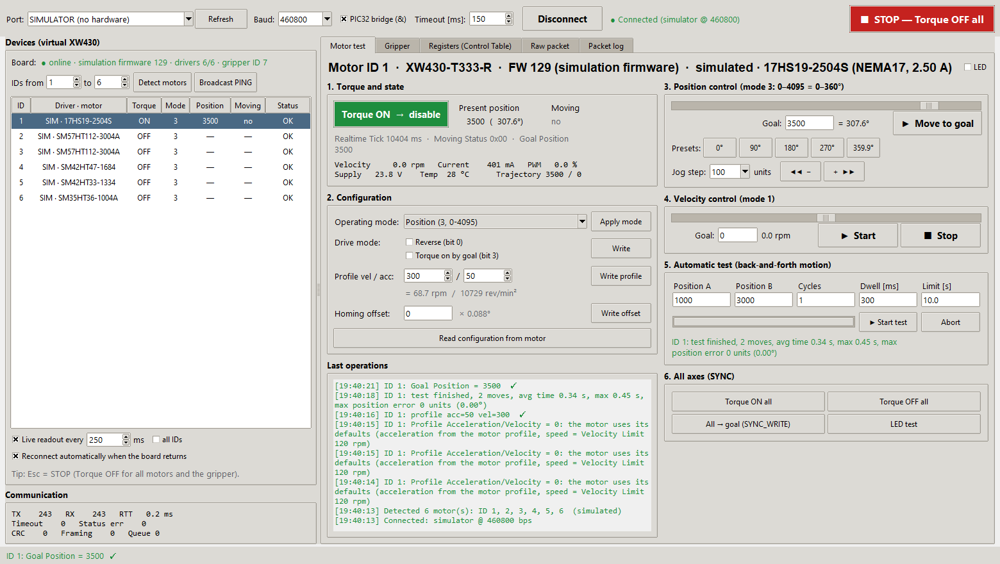
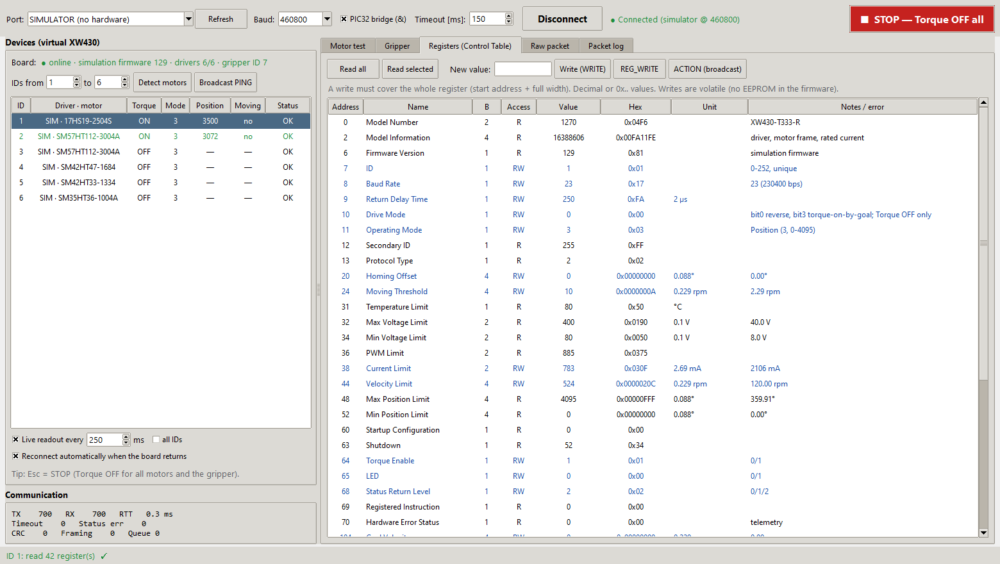
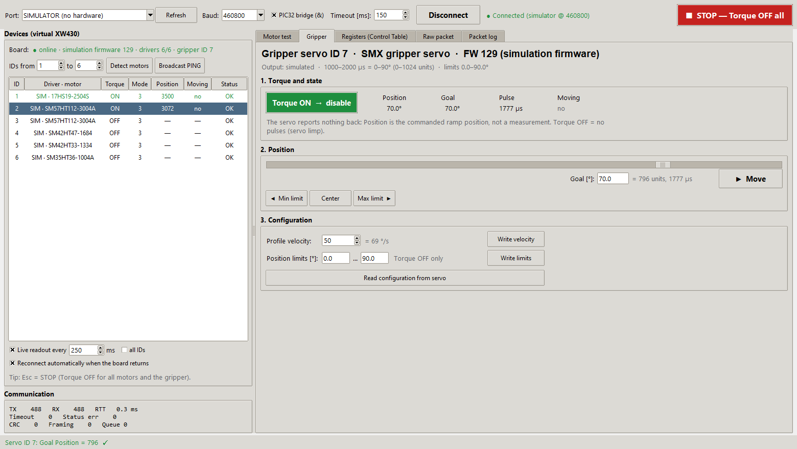
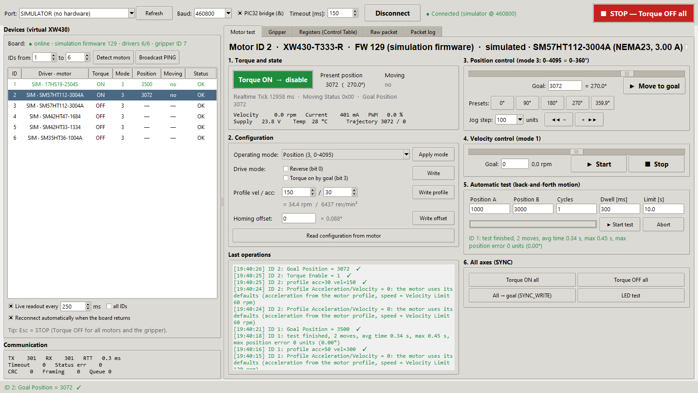

# Motor tester GUI

`tools/dxl_test_gui` is a desktop application for testing the firmware and
every stepper axis over **DYNAMIXEL Protocol 2.0**
([ROBOTIS specification](https://docs.robotis.com/docs/dxl/protocol/protocol2/)).
It acts as the bus master, the same role the Robot PC has. It runs on Windows
or Linux and needs only Python, Tkinter, and `pyserial`.



## Starting

| Way | Command |
| --- | --- |
| VS Code on Windows | **Ctrl+Shift+B** → **Run motor tester GUI** or **Run motor tester GUI (simulator)** |
| Windows, no VS Code | double-click `tools\dxl_test_gui\run_gui.bat` (creates `.venv` on first run) |
| Any OS | `.venv` Python: `python tools/dxl_test_gui/dxl_gui.py [--port COM5] [--sim] [--sim-uncalibrated]` |

Set up `.venv` first; see [Development environment](../development/index.md#host-python-environment-venv).

| Option | Meaning |
| --- | --- |
| `--port COM5` | Preselects a serial port |
| `--baud 460800` / `--baud Auto` | Preselects the PC port bit rate (default 460800, the kit's USB side) |
| `--no-pic32-bridge` | Does not send `&` after opening the port (direct USB-UART cable instead of the kit's PIC32 bridge) |
| `--sim` | Built-in Python simulator that behaves like the **simulation firmware** (motion and telemetry); no board needed |
| `--sim-uncalibrated` | Python simulator of the **target firmware** with an axis whose position scale is 0 (position and telemetry return Access Error) |

With the real board, flash the **simulation firmware** first. The firmware runs
on the kit, answers over the same UART, and simulates the axes, so you can test
the whole protocol path without motors. The device list then shows
**SIM · <motor>** for every axis, and the board line and motor title show
*simulation firmware* (Firmware Version 129).

## Connecting

1. Connect the kit's USB Mini-B to the PC. The port shows up as `COMx`
   (Windows) or `/dev/ttyACM0` (Linux).
2. Pick the port and keep **Baud 460800**, the rate between the PC and the
   kit's PIC32 (the PIC32 talks to the firmware at 230400). Keep
   **PIC32 bridge (&)** ticked: the PIC32 passes data to the
   SmartFusion2 only after it has received `&`, which the tool sends after
   opening the port and after every rate change (see
   [Host link](../hardware/wiring.md#host-link-usb-pic32-smartfusion2)). **Auto** tries
   460800, 230400, 115200, 57600, 1000000, 2000000, and 9600 bps and keeps the first
   rate at which a device answers a broadcast PING. If you pick another rate
   while connected, the tool switches the open port and detects the motors
   again. The connection label shows the rate in use. *Timeout* is the time the tool
   waits for each status packet (default 150 ms).
3. Click **Connect**. The tool runs **Detect motors**: it pings IDs 1-6, the
   controller (ID 200) and the gripper servo (ID 7), and lists the axes with
   their driver and motor (see below).

**Scan (PING)** searches any ID range. **Broadcast PING** asks every device to
answer at once.

## Motor detection and connection monitoring

**Detect motors** pings the chosen ID range and the controller device (ID 200).
It then reads each motor's **Model Information**. The device list shows:

- **Driver · motor** for every detected axis, for example
  `TMC5160 · 23HS2430 (NEMA23, 3.00 A)`. The driver is detected by the
  firmware; the motor frame and current are configured in the firmware. The GUI
  looks them up in the project's motor profiles
  (`apps/SmartManipulator_Controller/include/motor/motor_profiles.h`) to show
  the motor name. If several profiles share frame and current (23HS2430 and
  SM57HT112-3004A are both NEMA23, 3.0 A), the GUI shows the motor that
  `motor_axes.h` assigns to that ID.
- **⚠ config: …** after the motor when the board reports a different motor
  than `motor_axes.h` in this checkout assigns to that ID, for example after
  flashing a firmware built from another configuration. The log then says
  *Motor configuration differs from this project*; rebuild and flash, or
  update the checkout.
- **— not detected / absent** for axes whose driver did not answer, for example
  a missing module or no 24 V motor supply.
- **Board** line: `online · <variant> firmware <version> · drivers n/6 · gripper ID 7`.
  Green means all drivers were found, orange means some are missing. The
  gripper part is missing when the firmware has no servo.

This uses only standard DYNAMIXEL Protocol 2.0 transactions (PING and READ).

Connection monitoring runs continuously:

| Situation | What the GUI shows | What it does |
| --- | --- | --- |
| USB cable or board unplugged (port disappears or I/O fails) | **● Connection lost**; rows marked *port lost*; controls disabled | Closes the port. With *Reconnect automatically* checked, it reopens the port when it reappears and detects the motors again. |
| Port still open, but the board stops answering (power off, reset, firmware hang) | **● Port open, board not responding**, after 3 cycles without an answer | Keeps checking every second. When the board answers again, it re-detects the motors. |
| One axis stops answering while the board is alive | Row status *driver lost* | The rest keeps working; click **Detect motors** to update. |

When live readout is off, a one-second heartbeat (PING of the controller)
keeps the monitoring running.

## Window layout

| Area | Function |
| --- | --- |
| Top bar | Port, baud rate, **PIC32 bridge (&)**, timeout, Connect/Disconnect, connection state, and the red **STOP — Torque OFF all** button (key **Esc**; also switches the gripper servo off) |
| Device list | **Board** line, then one row per axis: ID, *Driver · motor* (`SIM · …` on the simulation firmware), torque, mode, present position, moving, status. With **Live readout** on, the selected motor (or all, with *all IDs*) is polled every N ms. *Reconnect automatically* reopens a lost port. |
| Communication | TX/RX counters, last round-trip time, timeouts, status errors, CRC and framing errors, worker queue |
| **Motor test** tab | Step-by-step test of the selected axis (below) |
| **Gripper** tab | Gripper servo (ID 7): torque, goal in degrees within the position limits, Min/Center/Max presets, Profile Velocity (ramp), position limits; live position, goal, pulse width (µs) and Moving while the tab is open (see [Testing the gripper servo](#testing-the-gripper-servo)) |
| **Registers** tab | Control Table browser: Read all, Read selected, WRITE, REG_WRITE, ACTION |
| **Raw packet** tab | Any instruction with hex parameters; stuffing and CRC are added for you |
| **Packet log** tab | Every TX/RX packet with timestamp, decoding, and hex dump; *Save to file…* |

## Testing one stepper axis

> Before you drive a motor, check that the device list shows the right motor
> for the axis (no ⚠ config warning) and follow the
> [bring-up checklist](../hardware/tmc5160.md#bring-up-checklist).
> **Detect motors** works without motor current: it only needs VM on the
> module (the TMC5160 logic is powered from VM).

1. **Select the motor** in the device list. The tool reads its configuration.
2. **Section 2, Configuration:**
   - *Operating mode*: Position (3), Extended position (4), or Velocity (1).
     Click **Apply mode**. The mode can change only with torque off; the tool
     offers to switch torque off first.
   - *Drive mode*: **Reverse** (bit 0) inverts the direction. **Torque on by
     goal** (bit 3) enables torque automatically on a new goal.
   - *Profile vel / acc*, for example 100 / 20, then **Write profile**. 0 means
     the motor defaults: speed = Velocity Limit (address 44), acceleration
     from the motor profile. Profile velocity above the Velocity Limit
     returns Data Range Error.
   - *Homing offset* shifts the zero (units of 0.088°).
3. **Section 1, Torque**: click the button to switch torque ON (green) or OFF.
   Below the present position, the telemetry line shows velocity (rpm),
   current (mA), PWM (%), supply voltage, temperature, and the position and
   velocity trajectory. On the target firmware the current is the TMC5160
   current setting in use, voltage and temperature are nominal values, and
   PWM is 0.
4. **Section 3, Position control**: use the slider (0–4095 = 0–360° in mode 3,
   ±4 turns in mode 4) or type a goal, then **Move to goal**. You can also use
   the 0°/90°/180°/270° presets or jog with − / + by the chosen step.
5. **Section 4, Velocity control** (mode 1): set a speed within ± the axis'
   Velocity Limit (× 0.229 rpm; the slider follows it), then **Start** / **Stop**.
6. **Section 5, Automatic test**: enter positions A and B, cycles, dwell, and a
   time limit, then **Start test**. The tool enables torque, moves A↔B, waits
   for *Moving = 0*, and reports each move's time and the final position error.
   **Abort** stops after the current step.
7. **Section 6, All axes**: Torque ON/OFF for all, all axes to the current goal
   with **SYNC_WRITE** (the firmware runs them one after another), and an LED
   test.

Every action is listed under **Last operations**: green for success, red for an
error, with a hint. For example, Access Error on position means the axis has no
position scale or the operating mode is wrong.



## Testing the gripper servo

The gripper servo (MG996R on CorePWM) is a separate virtual DYNAMIXEL device,
ID 7 by default. It has its own **Gripper** tab, not a row in the device list.



**Detection.** **Detect motors** asks the controller (ID 200) for the servo ID
(controller register 5) and then pings that ID. The **Board** line then ends
with *gripper ID 7*. If register 5 is 0, the firmware was built without
`CONFIG_SMX_SERVO`, and the tab shows *Gripper servo: not detected* with all
controls disabled. Without a controller answer, the tool tries the default
ID 7.

**Header.** The title shows the ID, the model (*SMX gripper servo*, model number
`0x5356`) and the firmware variant. The line below shows the output (CorePWM
on the target firmware, *simulated* on the simulation firmware), the pulse
range and travel, for example *1000–2000 µs = 0–90° (0–1024 units)*, and the
position limits in use.

| Section | Controls | Registers |
| --- | --- | --- |
| **1. Torque and state** | **Torque OFF → enable** / **Torque ON → disable**. Torque ON starts the 50 Hz pulses, Torque OFF stops them (the servo goes limp). Live values: *Position*, *Goal*, *Pulse* (µs, *off* with torque off) and *Moving*. | Torque Enable (64), Goal Position (116), Present Position (132), Moving (122) |
| **2. Position** | Slider and *Goal [°]* (Enter = Move), with the matching units and pulse width next to it. **Move** writes the goal. **Min limit**, **Center** and **Max limit** move to the position limits or their middle. | Goal Position (116) |
| **3. Configuration** | *Profile velocity* (0 = no ramp, the servo moves at its own full speed; each unit is 0.229 rpm, so 50 ≈ 69 °/s) and **Write velocity**. *Position limits [°]* and **Write limits** (Torque OFF only). **Read configuration from servo** loads velocity, limits, goal and torque into the tab. | Profile Velocity (112), Max/Min Position Limit (48/52) |

The units are the axis units, 0.088° each (4096 = 360°); the servo travel
0–90° is 0–1024.

Steps:

1. Open the **Gripper** tab. **Detect motors** has already read the servo
   configuration into it. While the tab is open, the live readout polls the
   servo instead of the selected axis.
2. Set **Profile velocity**, for example 50, and click *Write velocity*.
3. Click **Torque OFF → enable**. The first time after power-up the servo moves
   to the start position (45°) at full speed, because its real position is not
   known.
4. Enter a goal in degrees, drag the slider, or use *Min limit*, *Center*, *Max
   limit*, then click **Move**. The firmware ramps the pulse in 20 ms steps;
   *Moving* shows *YES* until the ramp ends.
5. Restrict the travel to what the gripper can do: switch torque off, enter
   the limits in section 3 and click *Write limits*. The slider then covers
   only the new range.

Rules and messages:

- A goal outside the position limits is refused in the GUI with a hint; the
  firmware would answer Data Range Error.
- A goal written with torque off is only stored (the log says so); the servo
  moves to it when torque is switched on.
- Position limits written with torque on return Access Error.
- **STOP** (Esc) also switches the servo torque off; on closing, the tool
  offers to switch torque off on all motors and the gripper.
- *Position* is the commanded ramp position, not a measurement: the MG996R
  has no feedback. Check the real position by eye.

## Messages you will see with the current firmware

| Message | Cause |
| --- | --- |
| Present position *unavailable* / Access Error on Goal Position | The axis has no position scale (only in `--sim-uncalibrated` or a firmware built without motor profiles) |
| Access Error on Drive Mode, Homing Offset, Current Limit, Velocity Limit | Torque is ON; these registers are written with Torque OFF only |
| Hardware Error Status bit 0 and Torque OFF by itself | The TMC5160 lost VM and restarted; the firmware configured it again. Position restarted at 0: switch Torque ON again |
| Access Error on Goal Velocity write in mode 3 | Wrong mode; Goal Velocity is written only in mode 1 |
| Access Error on *Operating Mode* | Torque is ON |
| Data Length Error | The write did not start at a register address or did not match its width |
| Values in the wrong fields, one step behind (only with an old GUI) | The PIC32 held back a final `%` byte, see [Host link](../hardware/wiring.md#host-link-usb-pic32-smartfusion2); current `DxlBus` adds a `0x00` after such packets |
| Timeout on every ID | Wrong port or baud rate (kit USB port: 460800; try **Auto**), **PIC32 bridge (&)** unticked, no power, firmware not running, or a text console active on the UART |
| Baud Rate register shows 23, not 460800 | Correct: the register reports the firmware UART (PIC32 ↔ SmartFusion2, 230400 bps; project code 23, 46 would be 460800). The PC port runs at 460800 |

## Automated check

`firmware_check.py` runs the same protocol transactions automatically and
prints PASS/FAIL. On the simulation firmware it runs 49 checks, including
motion, telemetry and the gripper servo. On the target firmware it runs the protocol checks only;
motion runs only with `--allow-motion`.

```powershell
.\.venv\Scripts\python.exe tools\dxl_test_gui\firmware_check.py --port COM5
.\.venv\Scripts\python.exe tools\dxl_test_gui\firmware_check.py --sim     # Python simulator
```



## Internals

| File | Role |
| --- | --- |
| `dxl_gui.py` | Tkinter user interface. A single worker thread runs all bus transactions; the user interface never blocks. |
| `dxl/protocol.py` | Protocol 2.0 codec: CRC-16, byte stuffing, stream parser, packet descriptions |
| `dxl/bus.py` | Thread-safe master: PING, broadcast PING, READ, WRITE, REG_WRITE, ACTION, SYNC_READ, SYNC_WRITE; statistics and packet log callback |
| `dxl/control_table.py` | XW430 register subset, servo and controller registers, units, operating modes |
| `dxl/motors.py` | Reads `motor_profiles.h` and `motor_axes.h`, names the motors and detects a configuration mismatch |
| `dxl/sim.py` | Simulator with the same instructions, register rules, and error codes as `dynamixel_x430.c` and `dynamixel_servo.c` (both variants) |
| `tmc_diag.py` | TMC5160 bring-up diagnostics through the raw register window (IOIN/SD_MODE, CHOPCONF, DRV_STATUS, MSCNT), optionally during a move |
| `firmware_check.py` | Automated conformance check against a port or the Python simulator |
| `tests/test_protocol.py` | Unit tests, including the firmware codec cross-check |

When the firmware's instructions, register rules, or error codes change,
update `dxl/sim.py` and `dxl/control_table.py` to match, then run the tests.
