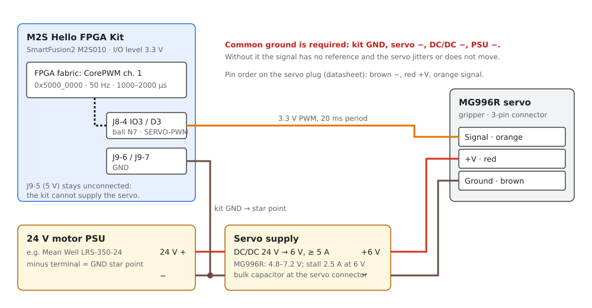

# Gripper servo (MG996R)

The gripper uses an MG996R hobby servo. The SmartFusion2 drives it with a
50 Hz pulse from CorePWM in the FPGA fabric. The firmware makes it a virtual
DYNAMIXEL device on ID 7, see [Gripper servo](../firmware/index.md#gripper-servo)
in the firmware architecture and the **Gripper** tab in the
[motor tester GUI](../gui/index.md#testing-the-gripper-servo).

> **Sources:** Handsontec *MG996R Metal Gear Servo Motor* user guide
> ([`Handsontec_MG996R_user_guide.pdf`](datasheets/Handsontec_MG996R_user_guide.pdf),
> [online](https://www.handsontec.com/dataspecs/motor_fan/MG996R.pdf)),
> [Hello FPGA Kit schematics Rev. 1](datasheets/Hello_FPGA_Kit_schematics_rev1.pdf),
> wiring concept [Rev. D](Wiring_RevD_DirectWiring_EN.pdf) and the Libero
> hardware contract (CorePWM). If this page and a source disagree, the source
> is authoritative; update this page.
>
> **Status (2026-10-11):** firmware and GUI are implemented and tested on the
> simulation firmware and `native_sim`. On the kit the servo follows Goal
> Position from the GUI (6 V supply with sufficient current). The travel
> (`SMX_SERVO_TRAVEL_DEG`) and the gripper limits are **not calibrated yet**.

## Datasheet values

| Parameter | Value (Handsontec user guide) |
| --- | --- |
| Operating voltage | 4.8–7.2 V |
| Stall torque | 9.4 kgf·cm at 4.8 V, 11 kgf·cm at 6 V |
| Operating speed | 0.17 s/60° at 4.8 V, 0.14 s/60° at 6 V |
| Running current | 500 mA |
| Stall current | 2.5 A at 6 V |
| Dead band width | 5 µs |
| Control signal | PWM, 20 ms period (50 Hz), 1–2 ms pulse |
| Positions | ~1 ms = one end ("−90"), 1.5 ms = middle ("0"), ~2 ms = other end ("90") |
| Rotation | approximately 120° (60° in each direction) |
| Weight, dimensions | 55 g; 40.7 × 19.7 × 42.9 mm (drawing: 40.3 mm between the mounting holes, 53.6 mm over the flanges, 47.6 mm high with the horn) |
| Connector | 3-pin, brown = ground (−), red = +V, orange = signal |

Notes on the values:

- Shop listings and this project's earlier notes give "180°" and "13 kg·cm".
  The user guide gives **about 120°** for the 1–2 ms range and **11 kgf·cm at
  6 V**. Plan the gripper with the datasheet values.
- The guide labels positions "−90 / 0 / 90" but also states 120° of travel.
  Measure the real angle per millisecond on the gripper (see
  [Calibration](#calibration)) instead of relying on either number.
- The signal in the guide's diagram is drawn at the supply level (~5 V). The
  guide gives no input threshold. The kit outputs **3.3 V** (see
  [Signal level](#signal-level)).

## Connection to the Hello FPGA Kit

| Servo wire | Connects to | Notes |
| --- | --- | --- |
| Orange (signal) | Kit **J8-4** = Arduino IO3 / D3, ball **N7**, net `MSIO104NB4_N7_ARD_INT1_PWM_IO3` | CorePWM channel 1, 3.3 V logic. Dupont m/f jumper, ≤ 30 cm |
| Red (+V) | **+6 V** of the servo DC/DC converter | Never from the kit (J9-5 5 V or 3V3): the kit is powered from USB and the servo draws up to 2.5 A |
| Brown (−) | **−** of the servo DC/DC converter, and through it the GND star point | The servo current must not flow through the kit or the Dupont wires |
| – | Kit **J9-6 / J9-7 (GND)** → GND star point (minus of the 24 V PSU) | Common reference for the signal. This connection is already part of the [wiring list](wiring.md#wiring-list-logic-dupont-mf-30-cm) |

Supply:

| Item | Specification |
| --- | --- |
| Converter | DC/DC 24 V → **6 V, ≥ 5 A**, used for the servo only. 6 V gives 11 kgf·cm (datasheet); stay within 4.8–7.2 V |
| Bulk capacitor | Recommended: low-ESR electrolytic of about 470–1000 µF / ≥ 10 V at the servo connector, against voltage dips at start and stall (not from the datasheet; project practice for hobby servos) |
| Wires | +6 V and − of the servo: ≥ 0.5 mm² (stall current 2.5 A). Only the signal goes over a Dupont jumper |
| Ground | Star point at the 24 V PSU minus. Kit GND, DC/DC minus and the servo − all meet there |

### Signal level

The kit I/O level is 3.3 V (IOREF = 3P3V); its pins must never see more than
3.3 V. The servo only receives the signal, so no voltage flows back into N7.
Most MG996R servos switch reliably at 3.3 V, but the datasheet does not
specify the input threshold.

- If the servo jitters or ignores the pulses although the oscilloscope shows a
  clean 50 Hz signal at J8-4, add a one-way level shifter, for example a
  74AHCT125 powered from 5 V (input 3.3 V compatible, output 5 V).
- Do not use a resistor pull-up to 6 V on the signal line: it would drive more
  than 3.3 V into N7.

## Signal from the firmware

| Setting | Value | Where |
| --- | --- | --- |
| Period | 20 ms (50 Hz): PRESCALE 99 → 1 µs tick at PCLK 100 MHz, PERIOD 19999 | `src/servo_corepwm.c`, Libero contract |
| Pulse width | 1000–2000 µs, 1 µs resolution (dead band of the servo: 5 µs) | Kconfig `SMX_SERVO_PULSE_MIN_US` / `_MAX_US` |
| Position scale | Goal Position 0 … range maps linearly to the pulse width; range = `SMX_SERVO_TRAVEL_DEG` in 0.088° units | Kconfig `SMX_SERVO_TRAVEL_DEG` (default 90) |
| Start | No pulses after reset and with Torque OFF (servo limp). The first Torque ON moves to `SMX_SERVO_INITIAL_DEG` (default 45° = 1500 µs) at full speed | Kconfig `SMX_SERVO_INITIAL_DEG` |
| Speed | Software ramp of the pulse width every 20 ms (Profile Velocity); 0 = jump, the servo moves at 0.14 s/60° | GUI **Gripper** tab, register 112 |

The default `SMX_SERVO_TRAVEL_DEG` of 90 only scales the degrees shown to the
host. With the datasheet's ~120° for 1–2 ms the gripper turns about 1.33 times
the displayed angle until the value is calibrated.

## Bring-up

Run these steps in order. Mount the servo without the horn or with the gripper
open, so a wrong pulse cannot crush anything.

1. **Firmware:** flash the target firmware. In the GUI, **Detect motors** shows
   *gripper ID 7* in the board line; the **Gripper** tab shows *Output:
   CorePWM*.
2. **Signal without the servo:** connect only an oscilloscope to J8-4 and GND.
   With Torque OFF the line stays low. Torque ON in the **Gripper** tab: 50 Hz,
   pulse 1500 µs (start position 45°). Move to the limits: 1000 µs and
   2000 µs. The *Pulse* field in the GUI shows the same values.
3. **Supply:** with the servo unplugged, set the DC/DC output to 6 V and
   check the common ground (kit GND to the PSU minus).
4. **Servo:** switch the 24 V PSU and the DC/DC off, plug the servo in (brown
   −, red +, orange signal), switch on, then Torque ON. The servo moves to the
   middle position at full speed.
5. **Slow test:** set *Profile velocity* to 20–50 (27–69 °/s) and move in
   small steps. Watch the servo supply voltage during moves.
6. **Limits:** find the open and closed gripper positions (see
   [Calibration](#calibration)), enter them as *Position limits* with Torque
   OFF, and click *Write limits*. Repeat after every reset: the limits are not
   stored.

## Calibration

The firmware cannot measure the servo position. Find the gripper's end
positions by hand:

1. Profile velocity about 30, Torque ON.
2. Move in steps of 1–2° towards *closed* until the jaws just touch, then back
   off by 2–3°. Note the angle. Do not hold the servo against a stop: it then
   draws up to the stall current of 2.5 A and heats up.
3. Do the same towards *open*.
4. Enter both values as *Position limits*. For a permanent default, change
   `SMX_SERVO_TRAVEL_DEG`, `SMX_SERVO_PULSE_MIN_US` / `_MAX_US` or
   `SMX_SERVO_INITIAL_DEG` in Kconfig and rebuild.

If the measured rotation for 1000–2000 µs differs from 90°, set
`SMX_SERVO_TRAVEL_DEG` to the measured angle so the GUI shows true degrees.

## Safety

1. Never power the servo from the kit (J9-5 5 V, J9-4 3V3) or over the
   breadboard.
2. Only 3.3 V signals on J8-4. No pull-up to the servo supply.
3. Plug or unplug the servo only with the DC/DC output off.
4. Torque OFF (or **STOP**, key Esc, in the GUI) removes the pulses: the
   servo is limp and the gripper may open under load.
5. The servo position after power-up is unknown. The first Torque ON moves at
   full speed to the start position: keep hands out of the gripper.
