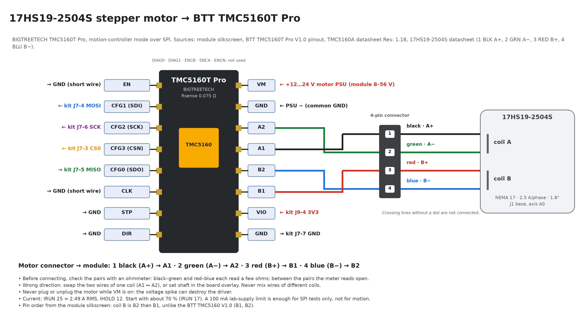

# TMC5160 driver modules

This page checks the wiring concept and the firmware's TMC5160 interface
against the manufacturer documents, records what has been verified on the
hardware, and lists what is still open before the motors are driven.

> **Hardware status (2026-10-11):** one BTT TMC5160T Pro (axis A0, motor
> 17HS19-2504S) is wired to the kit and detected over SPI (`IOIN.VERSION` =
> 0x30) by the target firmware through the GUI (460800 bps to the PIC32,
> 230400 bps to the SmartFusion2). Detection needed SPI 2 MHz in the overlay and
> CLK tied to GND. Registers, telemetry, Current Limit, the ramp generator and
> mode changes work on A0, but **the shaft does not turn**: the module reads
> `SD_MODE=1` (STEP/DIR mode), see finding 10. Currents and ramps come from
> per-motor profiles (`include/motor/motor_profiles.h`).

| Source | Revision | File |
| --- | --- | --- |
| BIGTREETECH TMC5160T Pro V1.0 pinout (module in use) | BTT wiki, checked 2026-10-10; module silkscreen | [bttwiki.com](https://global.bttwiki.com/TMC5160T%20Pro%20V1.0.html) |
| ADI Trinamic TMC5160/TMC5160A datasheet | Rev. 1.18, 2023-03-01 | [`TMC5160A_datasheet_rev1.18.pdf`](datasheets/TMC5160A_datasheet_rev1.18.pdf) |
| Microchip Hello FPGA schematics (DVP-100-000518-001) | Rev. 1, dated 02-07-2019 on the schematic | [`Hello_FPGA_Kit_schematics_rev1.pdf`](datasheets/Hello_FPGA_Kit_schematics_rev1.pdf) |
| 17HS19-2504S motor datasheet (wire colours) | – | pin 1 BLK A+, 2 GRN A−, 3 RED B+, 4 BLU B− |
| BIGTREETECH TMC5160 V1.0 schematic (`TMC5160.SchDoc`), reference module | 2019-03-27 | [`BIGTREETECH_TMC5160-V1.0_schematic.pdf`](datasheets/BIGTREETECH_TMC5160-V1.0_schematic.pdf) |
| BIGTREETECH TMC5160 V1.0 manual, reference module | V1.0 | [`BIGTREETECH_TMC5160-V1.0_manual.pdf`](datasheets/BIGTREETECH_TMC5160-V1.0_manual.pdf) |
| Direct wiring Hello FPGA Kit → 6× TMC5160 | Rev. D draft, 2026-10-07 | [`Wiring_RevD_DirectWiring_EN.pdf`](Wiring_RevD_DirectWiring_EN.pdf) |
| Zephyr `adi,tmc51xx` and `microchip,mpfs-spi` drivers | v4.5.0-rc1 (pinned in `west.yml`) | source in the west workspace |

The manufacturer PDFs are kept unchanged in `docs/hardware/datasheets/` (see
[Reference documents](#reference-documents)). The copyright stays with the
manufacturers. No schematic of the TMC5160T Pro is in the repository; where
this page needs board-level details (pull resistors, capacitors), it uses the
BTT TMC5160 V1.0 schematic as the closest reference and says so.

## The module in use: BIGTREETECH TMC5160T Pro

The modules fitted are the **BTT TMC5160T Pro** (silkscreen "TMC5160T pro"):
TMC5160 with external MOSFETs, RSENSE 0.075 Ω, 3.1 A RMS / 4.4 A
peak, VM 8–56 V. BTT lists "Operating Mode: SPI" and STP/DIR as "Pulse Input" /
"Direction Input": the module is made for 3D printer boards (Marlin), i.e.
TMC5160 **mode 2**, SPI for configuration plus STEP/DIR for the steps
(SD_MODE = 1). This project needs **mode 1**, the internal motion controller
(SD_MODE = 0); see finding 10.

| TMC5160 mode (datasheet ch. 1) | SD_MODE | SPI_MODE | Steps from |
| --- | --- | --- | --- |
| 1 Motion controller and driver (this project) | 0 | 1 | internal ramp generator (XTARGET over SPI) |
| 2 Step and direction driver (BTT "SPI mode") | 1 | 1 | STEP/DIR pins; SPI only configures |
| 3 Simple step and direction | 1 | 0 | STEP/DIR pins; no SPI |

| J1 pin | Signal | Connection | J2 pin | Signal | Connection |
| --- | --- | --- | --- | --- | --- |
| 1 | EN | → GND | 1 | VM | motor supply (+) |
| 2 | CFG1 / SDI | ← kit MOSI | 2 | GND | motor supply (−), common GND |
| 3 | CFG2 / SCK | ← kit SCK | 3 | A2 | coil A |
| 4 | CFG3 / CSN | ← kit CS*n* | 4 | A1 | coil A |
| 5 | CFG0 / SDO | → kit MISO (tristate while CSN is high) | 5 | **B2** | coil B |
| 6 | CLK | → GND, short wire (internal 12 MHz clock) | 6 | **B1** | coil B |
| 7 | STP (= REFL) | → GND | 7 | VIO | ← kit 3V3 (J9-4) |
| 8 | DIR (= REFR) | → GND | 8 | GND | common GND |

- EN is the pin in the white-marked box. DIAG0, DIAG1, ENCB, ENCA and ENCN
  (top pads) are not used.
- EN, CLK, STP and DIR must not float. On the BTT TMC5160 V1.0 these pins have
  no pull resistors, and the TMC5160 has none on CLK; a floating CLK prevented
  detection during the first test. Tie all four to GND.
- Coil B is in the order **B2, B1** (the V1.0 has B1, B2). Wire motors by pin
  name, not by position.

### Reference module: BIGTREETECH TMC5160 V1.0

The datasheets folder holds the schematic and manual of the older BTT
TMC5160 V1.0. It has the same logic header, but:

| | BTT TMC5160 V1.0 | BTT TMC5160T Pro (in use) |
| --- | --- | --- |
| Headers | J3 (logic), J4 (power) | J1 (logic), J2 (power) |
| Logic header | EN, SDI, SCK, CSN, SDO, CLK, STEP, DIR | same order |
| Power header | VM, GND, A2, A1, **B1, B2**, VCC_IO, GND | VM, GND, A2, A1, **B2, B1**, VIO, GND |
| VM | 8–40 V (FDMC8030 40 V MOSFETs) | 8–56 V |
| RSENSE, current | 0.075 Ω, 3.1 A RMS / 4.4 A peak | same (same current table) |
| VM capacitors | 2 × 10 µF + 470 nF | not documented |
| Extra pads | DIAG0, DIAG1 | DIAG0, DIAG1, ENCB, ENCA, ENCN |
| Mode selection | solder pads, see below | SPI mode by default |

If a V1.0 module is used, check its mode pads before wiring:

| Pad | Schematic | Connects | Required |
| --- | --- | --- | --- |
| **SPI** | W2 | SPI_MODE (22) to VCC_IO. Open = internal pull-down = standalone mode, SPI is off. | **Closed** |
| **SD** | W1 | SD_MODE (21) to VCC_IO. Open = 10 kΩ pull-down R5 = internal motion controller. | **Open** |

With **SD** closed, the chip expects STEP/DIR pulses and the firmware's ramp
commands do nothing. With **SPI** open, the chip does not answer on SPI and the
firmware reports the axis as absent.

## Motor connection: 17HS19-2504S

| Motor connector pin | Wire | Phase (motor datasheet) | Module pin |
| --- | --- | --- | --- |
| 1 | black (BLK) | A+ | A1 |
| 2 | green (GRN) | A− | A2 |
| 3 | red (RED) | B+ | B1 |
| 4 | blue (BLU) | B− | B2 |

- Coil A is black/green, coil B is red/blue. Check with an ohmmeter before you
  connect: each pair reads a few ohms, and between the pairs the meter reads
  open.
- Wrong direction: swap the two wires of **one** coil (A1 ↔ A2), or set
  `SMX_AXISn_INVERT` to 1 in `motor_axes.h` (the overlay then sets `shaft`).
  Never mix wires of different coils.
- Never plug or unplug the motor while VM is on.
- Rated current 2.5 A. The motor profile `M17HS19_2504S` sets IRUN 21
  (2.1 A RMS, about 85 %) and IHOLD 12 (1.25 A). A lab supply limited to 100 mA is enough for SPI tests only, not
  for motion.
- The other motors use different colour codes. The rule is always "one coil to
  A1/A2, the other to B1/B2". The connection order of all six motors is in
  [Motor connection order](wiring.md#motor-connection-order).

### Wire colours of the other motors

| Axis | Motor | A+ → A1 | A− → A2 | B+ → B1 | B− → B2 | Source |
| --- | --- | --- | --- | --- | --- | --- |
| A1a, A1b | 23HS2430 | red | green | **yellow** | blue | RATTMMOTOR datasheet |
| A2 | 17HS19-1684S-PG5 | black | green | red | blue | Seller page (silnikkrokowy.pl) |
| A3 | 17HS13-0404S1 | black | green | red | blue | StepperOnline standard, not checked against a datasheet |
| A4 | 14HS20-1504S | black | green | red | blue | StepperOnline standard, not checked against a datasheet |

- **23HS2430: red is A+, not B+.** On this motor coil A is red/green and coil B
  is yellow/blue. Wiring it with the 17HS19 colour code puts red on B1 and
  splits the coils.
- Before you connect a motor, check the pairs with an ohmmeter: 1.6 Ω per coil
  on the 23HS2430, about 1.7 Ω on the 17HS19-1684S-PG5, 30 Ω on the
  17HS13-0404S1 and 2.8 Ω on the 14HS20-1504S.

## Design assumptions compared with the sources

| Item | Project assumption (Rev. D) | Manufacturer documents | Result |
| --- | --- | --- | --- |
| Operating mode | Motion controller, `SD_MODE=0`, `SPI_MODE=1` | TMC5160T Pro: "Operating Mode: SPI" (BTT wiki) = SPI + STEP/DIR, mode 2; the wiki documents no SD/SPI selection. V1.0 schematic: jumpers W1 (SD_MODE) and W2 (SPI_MODE) | **Not met on A0** (2026-10-11): IOIN reads `SD_MODE=1`, the module runs SPI + STEP/DIR. SPI works (detection), but the internal ramp generator does not drive the motor. See finding 10 |
| Module | Pin names from the Watterott SilentStepStick | BTT TMC5160T Pro: J1/J2, VIO, coil B order B2, B1 | Wiring page updated |
| Logic level | 3.3 V from kit J9-4 to VIO | VCC_IO (VIO) 3.00–5.25 V; all digital pins use this level | OK; verified on hardware |
| Logic supply | TMC5160 logic is powered from VM | VCC_IO "does not supply internal logic"; VCC comes from 5VOUT, which comes from VSA = VM | OK; see power-up order below |
| Motor supply | 24 V | TMC5160T Pro 8–56 V (V1.0: 8–40 V); chip 10–55 V for full specification | OK |
| Bulk capacitance | Not specified | Datasheet: at least 100 µF per ampere of coil current near the power stage; the V1.0 has only 2 × 10 µF ceramics; the T Pro values are not documented | **Add an electrolytic per module** (≥ 330 µF / 50 V low-ESR for the 3 A axes, ≥ 220 µF for the others) |
| Motor current | 1.0–3.0 A | 0.075 Ω sense resistor: 3.06 A RMS full scale (3.1 A RMS / 4.4 A peak per BTT) | OK; all motors are below the module limit. The 3 A NEMA23 axes run near it (IRUN 26 = 2.6 A): keep a heatsink and airflow on those modules |
| EN | → GND | DRV_ENN, no pull resistor; low = power stage enabled. CHOPCONF.TOFF is 0 after reset, so the bridges stay off until the firmware enables them | OK; **must not float** |
| CLK | → GND, internal clock | "Tie to GND using short wire for internal clock"; internal oscillator 12.0 MHz typ. (11.5–12.5 MHz); no pull-down on CLK | OK; must not float. Overlay fixed to 12 MHz |
| STEP, DIR | → GND, stops disabled | In motion-controller mode these are the left/right reference inputs | OK |
| ENCN_DCO (pin 26) | – | "With SD_MODE=0, pull to GND or VCC_IO if not used"; not connected on the BTT V1.0; ENCN is a free pad on the T Pro | Low risk: only matters if the encoder interface is enabled (it is not) |
| SPI | Mode 3, ≤ 2 MHz, shared MISO | Mode 3, 40-bit datagrams; fSCK ≤ 4 MHz with the internal clock; SDO tristate while CSN high | OK; overlay fixed to 2 MHz (1.79 MHz SCK), verified on hardware |
| CS mapping | IO10, IO8, IO7, IO6, IO5, IO4 → SS0–SS5 | Kit balls M10, R10, T7, T8, P10, R9 match the schematic | OK |

### Kit pins checked against the Hello FPGA schematic

| Signal | Header | Arduino | Ball | Schematic net |
| --- | --- | --- | --- | --- |
| SCK | J7-6 | IO13 | R13 | `MSIO118NB4_R13_ARD_SCK/IO13` |
| MOSI | J7-4 | IO11 | R11 | `MSIO115NB4_R11_ARD_PWM_MOSI/IO11` |
| MISO | J7-5 | IO12 | T11 | `MSIO115PB4_T11_ARD_MISO/IO12` |
| CS0 → A0 | J7-3 | IO10 | M10 | `MSIO114NB4_M10_ARD_PWM_SS_IO10` |
| CS1 → A1a | J7-1 | IO8 | R10 | `MSIO113NB4_R10_ARD_IO8` |
| CS2 → A1b | J8-8 | IO7 | T7 | `MSIO110PB4_T7_ARD_IO7` |
| CS3 → A2 | J8-7 | IO6 | T8 | `MSIO110NB4_T8_ARD_PWM_IO6` |
| CS4 → A3 | J8-6 | IO5 | P10 | `MSIO109PB4_P10_ARD_PWM_IO5` |
| CS5 → A4 | J8-5 | IO4 | R9 | `MSIO106NB4_R9_ARD_IO4` |
| Servo PWM | J8-4 | IO3 | N7 | `MSIO104NB4_N7_ARD_INT1_PWM_IO3` |
| 3.3 V | J9-4 | 3V3 | – | `3P3V` (MCP1727 LDO, 1.5 A, from USB 5 V) |
| GND | J9-6, J9-7, J7-7 | GND | – | `GND` |

The MSS SPI_0 and MMUART_0 pads are wired to the PIC32 (SPI_0 on J12–J14/K12;
the host UART on H12/H13, `UART_TX_SF2`/`UART_RX_SF2`). The Libero design
therefore routes SPI_0 through the fabric to the Arduino pins, as assumed. The
J2 ICSP header shares R11, T11, R13 and RESET but is not fitted.

SCK, MOSI, MISO, CS0, 3V3 and GND were confirmed on the hardware on
2026-10-10 (axis A0 detected). The servo pin (N7) works since 2026-10-11 (the
servo follows Goal Position). CS1–CS5 are not tested yet.

The host link runs USB → MCP2221A → PIC32 (UART2) → PIC32 (UART4) → SF2. The
PC side runs at 460800 bps, the PIC32 → SmartFusion2 side at 230400 bps
(works on the hardware, 2026-10-10, GUI talking to the target firmware;
Microchip's own Hello FPGA demo uses the same rate on this path). The PIC32
forwards data only after the host has sent `&`. See
[Host link](wiring.md#host-link-usb-pic32-smartfusion2).

## Motor current settings

With GLOBALSCALER = 0 (full scale, the reset value) and RSENSE =
0.075 Ω:

IRMS = (CS + 1) / 32 × 0.325 V / 0.075 Ω / √2 = (CS + 1) × 0.0958 A

These values are set in the motor profiles (`motor_profiles.h`):

| Axis | Motor profile | Rated | IRUN | IHOLD |
| --- | --- | --- | --- | --- |
| A0 J1 base | `M17HS19_2504S` | 2.5 A | 21 → 2.11 A | 12 → 1.25 A |
| A1a, A1b J2 shoulder | `M23HS2430` | 3.0 A | 26 → 2.59 A | 15 → 1.53 A |
| A2 J3 elbow | `M17HS19_1684S_PG5` | 1.68 A | 14 → 1.44 A | 8 → 0.86 A |
| A3 J4 forearm roll | `M17HS13_0404S1` | 0.4 A | 3 → 0.38 A | 1 → 0.19 A |
| A4 J5 wrist | `M14HS20_1504S` | 1.5 A | 12 → 1.24 A | 7 → 0.77 A |

IRUN is about 85 % of the rated current, IHOLD about 50 %. The 0.4 A
17HS13-0404S1 is the exception: the nearest steps are CS 2 (0.29 A, 72 %) and
CS 3 (0.38 A, 96 %), and the profile uses CS 3. With such small CS values the
current resolution is coarse (the datasheet recommends CS ≥ 16); a lower
GLOBALSCALER on that module would fix it but is not implemented. Raise IRUN only if an
axis loses steps and the motor stays below about 80 °C.

## Motor profiles and axis assignment

The motor data lives in two headers in
`apps/SmartManipulator_Controller/include/motor/`:

- `motor_profiles.h`: one block of `MOTOR_<KEY>_<FIELD>` macros per motor
  type: name, NEMA frame, rated current, holding torque, full steps,
  `MAX_RPM` (default Velocity Limit, a bench value: 120 rpm for NEMA17/14,
  60 rpm for NEMA23), IRUN/IHOLD/IHOLDDELAY and the six-point ramp (VSTART,
  A1, V1, AMAX, VMAX, DMAX, D1, VSTOP).
- `motor_axes.h`: which profile drives which axis (`SMX_AXISn_MOTOR`,
  n = 0…5 = DYNAMIXEL ID 1…6), direction (`SMX_AXISn_INVERT`, adds `shaft;`)
  and the gear ratio (`SMX_AXISn_GEAR_NUM` / `_DEN`), plus the common
  microstep setting (`SMX_MICROSTEPS` = 16).

The board overlay includes `motor_axes.h` and takes every per-axis property
from it; `main.c` computes the position scale
(full steps × microsteps × NUM / DEN) and reports the frame and rated current
in Model Information. The GUI reads the same headers, so **Detect motors** shows
the motor name and warns when a module reports a different motor than the
project expects.

To move a motor to another joint, change `SMX_AXISn_MOTOR` and rebuild with
`west build -p` (pristine, because the overlay changes). To add a motor type,
copy a profile block and keep the macro format (`#define MOTOR_KEY_FIELD
value`): the GUI parses it.

Ramp units with the 12 MHz internal clock and 16 microsteps
(3200 µsteps per motor revolution):

| Register | Unit | 1 rev/s or 1 rev/s² |
| --- | --- | --- |
| VSTART, V1, VMAX, VSTOP | 0.715 µsteps/s | 4474 |
| A1, AMAX, DMAX, D1 | 65.5 µsteps/s² | 49 |

The profiles use VMAX 4474 (1 rev/s) and AMAX 98 (2 rev/s²) for the NEMA17/14
motors and VMAX 2237, AMAX 49 for the NEMA23 shoulder. V1 = 0 disables the
A1/D1 phase; D1 must still be ≥ 1, and VSTOP must be ≥ VSTART.

## Firmware interface review

Scope: `boards/m2s_hello_fpga_kit_m2s010.overlay`, `src/motor_tmc5160.c`, and
the Zephyr drivers they use (`adi,tmc51xx`, `microchip,mpfs-spi`). The code was
analysed first; the SPI path and detection were then confirmed on the hardware
(2026-10-10), and the register mapping and ramp generator on axis A0
(2026-10-11). The motor has not turned yet (finding 10).

### What is correct

- **Datagrams:** 40 bits, MSB first, address byte with bit 7 = write. A read
  sends the address twice and takes the data from the second reply, as the
  datasheet requires (the first reply carries the previous request's data).
- **SPI mode 3:** the driver and `motor_tmc5160.c` request `CPOL | CPHA`; the
  MSS SPI driver maps them to SPO/SPH.
- **Chip select:** each `spi_transceive` is one 5-byte packet with hardware
  slave select SS0–SS5 (`reg = <0>`…`<5>`); SS is released after the packet,
  so the TMC5160 latches each datagram on the rising CSN edge.
- **Detection:** `tmc_read_version()` reads IOIN and checks VERSION (bits
  31…24) = 0x30, the value for the TMC5160 and TMC5160A.
- **Power-on safety:** CHOPCONF.TOFF = 0 after reset, so with EN tied to GND
  the bridges stay off until Torque ON calls `stepper_enable()`.
- **Ramp limits:** VSTOP (20 in every profile) ≥ VSTART (10). Profile Acceleration 0
  selects the profile's AMAX, so D1 is never 0 in positioning mode; VMAX and
  AMAX are cut to their register limits before they are written.

### Findings

| # | Severity | Finding | Fix | Status |
| --- | --- | --- | --- | --- |
| 1 | **Critical** | **SPI clock.** The MSS SPI driver searches CLK_GEN only from 1 to 15, so it cannot reach rates below PCLK/30 = 1.67 MHz. For the old overlay value of 1 MHz it kept CLK_GEN = 0, and the bus ran at 50 MHz / 2 = **25 MHz** (TMC5160 limit: 4 MHz). | Set `spi-max-frequency = <2000000>`: CLK_GEN = 13, SCK = 50 MHz / 28 = 1.79 MHz. Any value from 1.67 to 4 MHz works; never below 1.67 MHz. | **Fixed**, verified on hardware |
| 2 | **Critical** | **Clock frequency.** The overlay had 16 MHz; with CLK on GND the chip runs on its internal 12 MHz. Every speed and acceleration conversion is about 33 % off. | `clock-frequency = <12000000>`. | **Fixed** in overlay |
| 3 | **Critical** | **Stop on stall is always on.** The pinned driver writes SW_MODE.sg_stop = 1 at init and re-enables it from a work item, whatever `activate-stallguard2` says. Above the TCOOLTHRS speed (old demo value 100, about 140 rpm motor speed) an untuned StallGuard2 can stop the motor, and the axis stays stopped until sg_stop is cleared. The firmware never clears it. | Set `tcoolthrs = <0>` (disables stop on stall and CoolStep), or clear SW_MODE in `motor_tmc5160.c` after init. | **Fixed** in overlay |
| 4 | High | **Motor power switched on after the kit.** TMC5160 logic runs from VM. If VM comes later, or drops, the chip restarts with reset values: the overlay settings (MRES, currents, ramp, GCONF, SW_MODE) are lost. A PING re-detects the driver, but nothing is configured again. | `motor_tmc5160.c` reads GSTAT before every command; after GSTAT.reset it writes the configuration again, reports Torque OFF and Hardware Error bit 0 (input voltage), and refuses the pending move. The position restarts at 0. | **Fixed** in `motor_tmc5160.c` (`tmc_check_reset()`) |
| 5 | High | **Currents** were demo values (IRUN 2, IHOLD 1). | Per-axis values from the motor profiles (table above). | **Fixed** (`motor_profiles.h`) |
| 6 | High | **Shoulder direction.** The wiring requires `shaft=1` on A1b; the overlay does not set `shaft` on `tmc5160_axis2`. | Set `SMX_AXIS2_INVERT` to 1 in `motor_axes.h` after the mechanics confirm the motors face each other. | Open |
| 7 | Medium | **Chopper off time.** `stepper_enable()` sets CHOPCONF bits 3…0 to 1111b (TOFF = 15). That works, but gives a low chopper frequency (audible noise, more ripple); the datasheet example uses TOFF = 3. | After enable, write CHOPCONF = `0x000100C3` with the axis' MRES bits (TOFF = 3, HSTRT = 4, HEND = 1, TBL = 2), or patch the driver. | **Fixed** in `motor_tmc5160.c` (`tmc_enable()`) |
| 8 | Medium | **MSS SPI driver.** `mss_spi_disable_ints()` inverts its mask and clears every CONTROL bit except the interrupt enables after each transfer; the next transfer rewrites them. The SCK idle level between transactions is therefore not guaranteed (it may be low instead of high). The unused `speed` variable is the source of the known build warning. | Works because CSN is high between packets. Confirm SCK/CSN timing with a logic analyser during bring-up; report upstream. | Open |
| 9 | Low | `tmc_read_version()` bypasses the driver's register lock. At boot the driver's StallGuard work item can read the same chip between the two datagrams of a probe. | Effect: one wrong probe at boot at most. Probe again after init, or read through the driver. | Open |
| 10 | **Critical** | **Module in STEP/DIR mode.** On axis A0 `IOIN` = 0x30000040: `SD_MODE=1`. With SD_MODE high the TMC5160 takes its steps from the STEP/DIR pins (tied to GND here), not from the internal ramp generator. Measured during a move: XACTUAL and VACTUAL change, but the microstep counter MSCNT stays constant, DRV_STATUS.stst = 1 and CS_ACTUAL = IHOLD. The shaft only holds; Present Position changes without motion. | Pull SD_MODE low: on the BTT TMC5160 V1.0 open solder jumper W1 (SD) and keep W2 (SPI) closed; on the T Pro find the equivalent SD/SPI selection (not documented in the sources here). Check with `tools/dxl_test_gui/tmc_diag.py`: it must report `SD_MODE=0`, and MSCNT must change during `--move`. | **Open** (hardware) |

Findings 1–3 are fixed in the board overlay (`SMX_TMC5160_SPI_HZ` 2 MHz,
`SMX_TMC5160_CLOCK_HZ` 12 MHz, `SMX_TMC5160_TCOOLTHRS` 0). Finding 1 was the
cause of the failed first detection: with the old 1 MHz setting the bus ran at
25 MHz.

## Bring-up checklist

| # | Step | Status |
| --- | --- | --- |
| 1 | Module in SPI motion-controller mode: SPI pad closed, **SD pad open (SD_MODE = 0)**. Check with `tmc_diag.py` (`SD_MODE=0`). | **Open on A0**: reads SD_MODE=1 (finding 10) |
| 2 | EN, CLK, STP, DIR to GND (short wires); VIO to J9-4 (3.3 V). | Done on A0 |
| 3 | Overlay: SPI 2 MHz, clock 12 MHz, TCOOLTHRS 0. | Done |
| 4 | 24 V (or a current-limited lab supply for the SPI test) on first, then the kit (USB). **Detect motors** in the GUI: each module reports `TMC5160`. | Done on A0 (12 V / 100 mA) |
| 5 | Electrolytic capacitor at VM/GND of every module. | Open |
| 6 | Per-axis `irun`/`ihold` and ramps from the motor profiles (done); `SMX_AXIS2_INVERT` for A1b; pristine build. | Partly done |
| 7 | Motor wired as in [Motor connection](#motor-connection-17hs19-2504s), with VM off. | Open |
| 8 | One axis at a time on the 24 V supply: Torque ON, short moves at low speed, check direction and temperature. | Open |

## Reference documents

| File | Publisher | Use it for |
| --- | --- | --- |
| [`TMC5160A_datasheet_rev1.18.pdf`](datasheets/TMC5160A_datasheet_rev1.18.pdf) | Analog Devices (Trinamic) | Register map, SPI datagrams and timing, current scaling, StallGuard2/CoolStep, power-up behaviour, external component rules |
| [`BIGTREETECH_TMC5160-V1.0_schematic.pdf`](datasheets/BIGTREETECH_TMC5160-V1.0_schematic.pdf) | BIGTREETECH | Reference module: headers J3/J4, SPI and SD pads (W2, W1), sense resistors, missing pull resistors |
| [`BIGTREETECH_TMC5160-V1.0_manual.pdf`](datasheets/BIGTREETECH_TMC5160-V1.0_manual.pdf) | BIGTREETECH | Reference module: supply range (8–40 V), current limits (3.1 A RMS, 4.4 A peak), EN pad marking, handling precautions |
| [BTT TMC5160T Pro V1.0 wiki](https://global.bttwiki.com/TMC5160T%20Pro%20V1.0.html) | BIGTREETECH | Module in use: pinout J1/J2, VM 8–56 V, RSENSE 0.075 Ω |
| [`Hello_FPGA_Kit_schematics_rev1.pdf`](datasheets/Hello_FPGA_Kit_schematics_rev1.pdf) | Microchip | Arduino header nets and balls, 3.3 V supply, PIC32/MCP2221A host link, MSS pads wired to the PIC32 |
| [`Wiring_RevD_DirectWiring_EN.pdf`](Wiring_RevD_DirectWiring_EN.pdf) | project (bavariamatic) | Stage-1 wiring concept, motor list, power and servo |
| [`Handsontec_MG996R_user_guide.pdf`](datasheets/Handsontec_MG996R_user_guide.pdf) | Handsontec | Gripper servo MG996R: supply 4.8–7.2 V, currents, 1–2 ms / 20 ms signal, pinout; see [Gripper servo](servo.md) |

When a module or kit revision changes, replace the PDF, update the revision in
the [sources table](#tmc5160-driver-modules) and re-check the tables on this
page and on [Hello FPGA Kit wiring](wiring.md).
