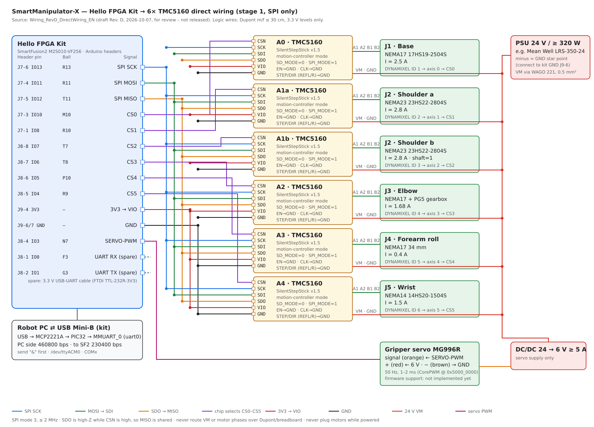
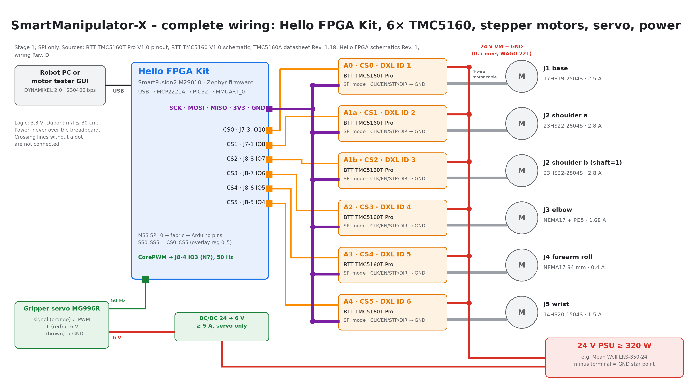
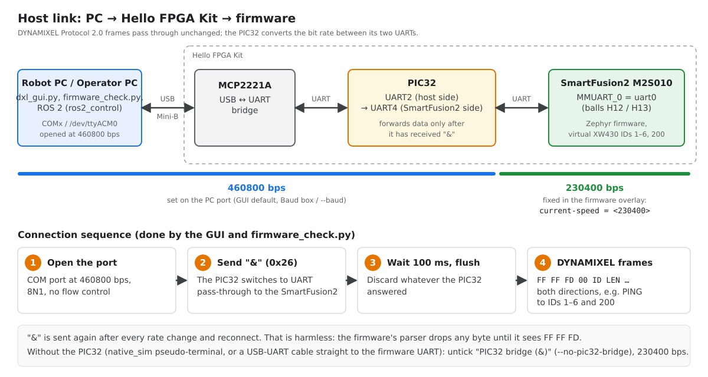
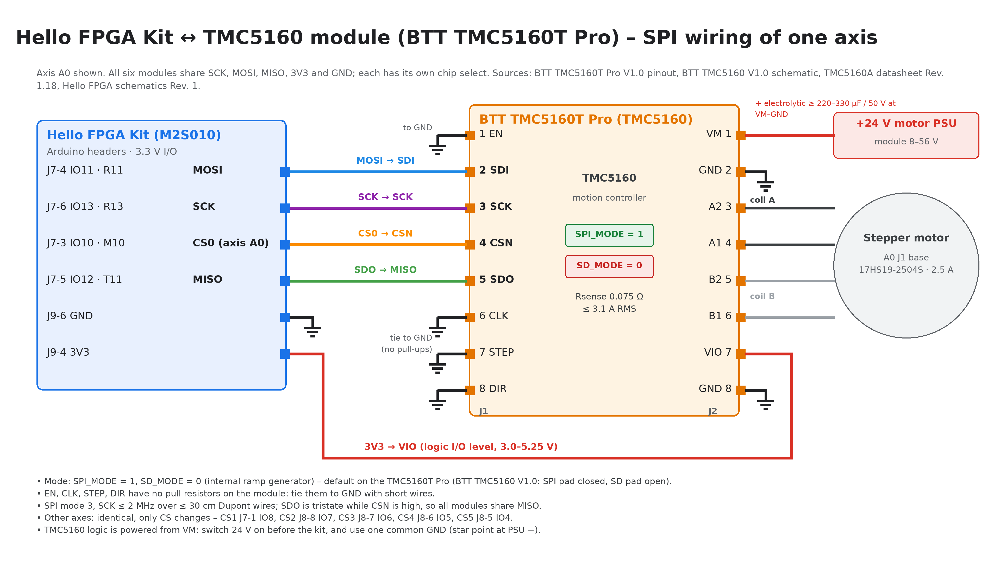

# Hello FPGA Kit wiring

This page covers stage 1: SPI-only direct wiring of the M2S Hello FPGA Kit
(SmartFusion2 M2S010-VF256) to six TMC5160 modules, the gripper servo, and the
power supply.

> **Source and status:** *Robot Arm Demonstrator: Direct Wiring Hello FPGA Kit →
> 6× TMC5160 (Stage 1, SPI only)*, draft Rev. D, 2026-10-07, bavariamatic. It
> is **for review and not released**, and it supersedes Rev. C (which had home
> switches). The original is in
> [`Wiring_RevD_DirectWiring_EN.pdf`](Wiring_RevD_DirectWiring_EN.pdf). Pin
> source: Hello FPGA schematics Rev. 1, p. 11. If this page and the PDF
> disagree, the PDF is authoritative; update this page to match it.
>
> **Manufacturer documents** (in [`datasheets/`](tmc5160.md#reference-documents)):
> [TMC5160A datasheet Rev. 1.18](datasheets/TMC5160A_datasheet_rev1.18.pdf),
> [Hello FPGA Kit schematics Rev. 1](datasheets/Hello_FPGA_Kit_schematics_rev1.pdf),
> [BTT TMC5160T Pro pinout](https://global.bttwiki.com/TMC5160T%20Pro%20V1.0.html)
> (module in use), and the reference module
> [BTT TMC5160 V1.0 schematic](datasheets/BIGTREETECH_TMC5160-V1.0_schematic.pdf)
> and [manual](datasheets/BIGTREETECH_TMC5160-V1.0_manual.pdf).
>
> **Verified on hardware (2026-10-10/11):** host link (PIC32 ↔ SmartFusion2 at
> 230400 bps, see [Host link](#host-link-usb-pic32-smartfusion2)); SCK, MOSI,
> MISO, CS0, 3V3 and GND to one TMC5160T Pro (axis A0 detected, registers and
> ramp generator work); the servo signal on J8-4 (the servo follows Goal
> Position). The A0 shaft does not turn yet because the module runs in
> STEP/DIR mode (finding 10 in [TMC5160 driver modules](tmc5160.md#findings)).
> CS1–CS5 and the other motors are not tested yet.
>
> **Gripper servo:** connection, supply, signal level and bring-up are on
> [Gripper servo (MG996R)](servo.md).

The module pinout, the motor connection, the check against the manufacturer
documents, and the firmware review are on [TMC5160 driver modules](tmc5160.md).

## Concept

- Each TMC5160 runs in **motion-controller mode** (`SD_MODE=0`, `SPI_MODE=1`).
  The ramps run inside the driver. The BTT TMC5160T Pro on A0 currently reads
  `SD_MODE=1` and must be switched (finding 10 in
  [TMC5160 driver modules](tmc5160.md#findings)). The kit drives only **SPI plus six chip
  selects**; it provides no STEP/DIR, EN, or DIAG signals.
- **No limit switches** in stage 1, because the mechanics have none. As on the
  original Moveo, positioning is open-loop:
  1. With the power off, move the arm by hand to the defined start pose.
  2. At power-up, every TMC5160 starts with `XACTUAL = 0` (reset value), so
     the start pose is position 0. The firmware does not home.
  3. The joint ranges are enforced as software limits (firmware or
     `ros2_control`).
- **Host link:** USB Mini-B → MCP2221A → PIC32 → SmartFusion2 MMUART_0. The
  link carries DYNAMIXEL Protocol 2.0 and appears on the Robot PC as
  `/dev/ttyACM0`. PC side 460800 bps, firmware side 230400 bps; the PIC32
  passes data only after the host has sent `&`. See
  [Host link](#host-link-usb-pic32-smartfusion2).

## Host link (USB → PIC32 → SmartFusion2)

The PC does not talk to the SmartFusion2 directly. The kit's USB Mini-B port
leads to an MCP2221A USB-UART bridge, then to a PIC32, and only the PIC32 is
wired to MMUART_0 of the SmartFusion2. The two UART segments run at
**different bit rates**; the PIC32 converts between them.

| Segment | Bit rate | Where it is set |
| --- | --- | --- |
| PC ↔ MCP2221A ↔ PIC32 (UART2) | **460800 bps** | Serial port on the PC: GUI *Baud* box (default 460800), `--baud` of `dxl_gui.py` and `firmware_check.py` |
| PIC32 (UART4) ↔ SmartFusion2 MMUART_0 | **230400 bps** | Firmware: `current-speed` of `uart0` in both board overlays; the PIC32 firmware uses the same rate on its side |

**The PIC32 forwards nothing until it has received the character `&`
(0x26).** After opening the port, the host therefore:

1. opens the port at 460800 bps (8N1, no flow control),
2. sends `&`, which switches the PIC32 to UART pass-through,
3. waits about 100 ms and discards any bytes received so far,
4. sends DYNAMIXEL Protocol 2.0 frames (`FF FF FD 00 …`) in both directions.

The GUI and `firmware_check.py` do this automatically (checkbox
**PIC32 bridge (&)**, on by default; `--no-pic32-bridge` turns it off). They
send `&` again after every rate change and reconnect. That is harmless: the
firmware's parser drops any byte until it sees the `FF FF FD` header. A ROS 2
driver or any other host program on the Robot PC must send `&` once after
opening the port in the same way.

**The PIC32 holds back a `%` (0x25) that ends a packet** until the next byte
arrives (measured on the kit, 2026-10-11: only this value, only towards the
SmartFusion2, `%` inside a packet passes normally). A request whose CRC ends
with 0x25 (for example READ 120/4, Realtime Tick + Moving, which the GUI polls)
reached the firmware only together with the next request, so every reply
arrived one transaction late. The host therefore sends one `0x00` byte after
any packet that ends with 0x25; the firmware's parser drops it. `DxlBus` in
`tools/dxl_test_gui/dxl/bus.py` does this, and also ignores a status packet
whose data length does not match the request (a late reply). Any other host
program must do the same.

Consequences:

- The Baud Rate register (address 8) of the virtual servos reports code 23 =
  230400 bps, the firmware side. It does not show the 460800 of the PC port.
- Changing the PC rate does not change the firmware rate, and the reverse.
  `current-speed` in the overlays must stay at the rate the PIC32 uses towards
  the SmartFusion2 (230400).
- Without the PIC32 (firmware running as `native_sim`, or a USB-UART cable
  straight to the firmware UART), untick **PIC32 bridge (&)**. On a cable, use
  230400 bps; on the `native_sim` pseudo-terminal the rate does not matter.

## Wiring list (logic, Dupont m/f, ≤ 30 cm)

| Kit pin | Arduino | Ball | Signal | Destination |
| --- | --- | --- | --- | --- |
| J7-6 | IO13 | R13 | SPI SCK | → SCK of all 6 modules |
| J7-4 | IO11 | R11 | SPI MOSI | → SDI of all 6 modules |
| J7-5 | IO12 | T11 | SPI MISO | ← SDO of all 6 modules |
| J7-3 | IO10 | M10 | CS0 | → CSN A0 (J1 base) |
| J7-1 | IO8 | R10 | CS1 | → CSN A1a (J2 shoulder a) |
| J8-8 | IO7 | T7 | CS2 | → CSN A1b (J2 shoulder b) |
| J8-7 | IO6 | T8 | CS3 | → CSN A2 (J3 elbow) |
| J8-6 | IO5 | P10 | CS4 | → CSN A3 (J4 forearm roll) |
| J8-5 | IO4 | R9 | CS5 | → CSN A4 (J5 wrist) |
| J8-4 | IO3 | N7 | SERVO-PWM | → servo signal (orange), see [Gripper servo](servo.md) |
| J8-1 | IO0 | F3 | UART RX | ← TXD of the USB-UART (spare) |
| J8-2 | IO1 | G3 | UART TX | → RXD of the USB-UART (spare) |
| J9-4 | 3V3 | – | VIO | → VIO (J2-7) of all 6 modules |
| J9-6/7, J7-7 | GND | – | GND | → GND of the modules, servo, UART, and PSU minus |

Use a Dupont splitter or a breadboard for the SPI bus to the six modules.
**Logic signals only** go over the breadboard.

## Axes and motors

### Motor connection order

Connect the motors in this order. Each motor goes to its own TMC5160 module,
and each module's CSN goes to the chip select in the same row. Swapping two
motors gives them the wrong current and ramp, and swapping two CS lines moves
the motor to another DYNAMIXEL ID.

| No. | Module | CS (kit pin) | Joint | Motor | Rated current | DYNAMIXEL ID → firmware axis |
| --- | --- | --- | --- | --- | --- | --- |
| 1 | A0 | CS0 (J7-3) | J1 base | NEMA17 17HS19-2504S | 2.5 A | ID 1 → axis 0 |
| 2 | A1a | CS1 (J7-1) | J2 shoulder (a) | NEMA23 23HS2430 | 3.0 A | ID 2 → axis 1 |
| 3 | A1b | CS2 (J8-8) | J2 shoulder (b) | NEMA23 23HS2430 | 3.0 A, `shaft=1` | ID 3 → axis 2 |
| 4 | A2 | CS3 (J8-7) | J3 elbow | NEMA17 17HS19-1684S-PG5 (gearbox 5.18:1) | 1.68 A | ID 4 → axis 3 |
| 5 | A3 | CS4 (J8-6) | J4 forearm roll | NEMA17 17HS13-0404S1 | 0.4 A | ID 5 → axis 4 |
| 6 | A4 | CS5 (J8-5) | J5 wrist | NEMA14 14HS20-1504S | 1.5 A | ID 6 → axis 5 |

- Both shoulder motors (rows 2 and 3) are the same type and drive the same
  joint. A1b faces A1a, so it runs mirrored: set `SMX_AXIS2_INVERT` to 1 once
  the mechanics confirm it (see [Implications for the firmware](#implications-for-the-firmware)).
- The J3 elbow motor has a built-in planetary gearbox (5.18:1, at most 2 N·m
  at the output). `motor_axes.h` sets the gear ratio 57/11 on axis 3, so the position of ID 4 refers to the gearbox
  output shaft, not the motor shaft.
- The 17HS13-0404S1 (J4) is a 0.4 A motor. Never connect it to a module that
  runs a profile for a larger motor: it would get several times its rated
  current and overheat.
- Coil wiring: one coil to A1/A2, the other to B1/B2. The wire colours differ
  between the motor types (the 23HS2430 has red A+ and **yellow B+**), see
  [Wire colours of the other motors](tmc5160.md#wire-colours-of-the-other-motors).
  Never plug or unplug a motor while VM is on.

The ID → axis → CS mapping comes from `main.c` (IDs 1-6) and the overlay
(`reg = <0>`…`<5>`). Which motor sits on which axis is set in
`apps/SmartManipulator_Controller/include/motor/motor_axes.h`; the motor data
(current, ramp) is in `motor_profiles.h` next to it. See
[Motor profiles and axis assignment](tmc5160.md#motor-profiles-and-axis-assignment).
The table shows the current assignment. The earlier planned motors
(SM57HT112-3004A, SM42HT47-1684, SM42HT33-1334, SM35HT36-1004A) remain in
`motor_profiles.h` as alternatives; they are not assigned to any axis.

## Fixed wiring on each TMC5160 module

The modules are **BIGTREETECH TMC5160T Pro** (RSENSE 0.075 Ω,
VM 8–56 V, SPI mode by default). Rev. D used Watterott SilentStepStick pin
names; the BTT names and header pins are below. Full pinout and the
differences to the BTT TMC5160 V1.0: [TMC5160 driver modules](tmc5160.md).

| Module pin | Connection |
| --- | --- |
| J1-4 CSN (CFG3) | its own CS line (table above) |
| J1-3 SCK (CFG2), J1-2 SDI (CFG1), J1-5 SDO (CFG0) | shared SPI bus |
| J2-7 VIO | 3V3 (J9-4) |
| J2-8 GND | common GND |
| J1-1 EN | → GND (must not float). The power stage stays off after reset (`CHOPCONF.TOFF=0`) until the firmware enables it over SPI. |
| J1-6 CLK | → GND, short wire (internal 12 MHz clock). A floating CLK prevents detection. |
| J1-7 STP, J1-8 DIR (= REFL, REFR) | → GND; `SW_MODE` stops disabled |
| J2-1 VM, J2-2 GND (power) | 24 V via WAGO 221, 0.5 mm² stranded wire soldered to the module pins |
| VM bulk capacitor | electrolytic at VM/GND of every module: ≥ 330 µF / 50 V low-ESR on the 3 A axes, ≥ 220 µF / 50 V on the others |
| J2-3/4 A2 A1, J2-5/6 **B2 B1** | motor phases: coil A on A1/A2, coil B on B1/B2. Note the order B2, B1. |

Motor wiring for the 17HS19-2504S (black A+ → A1, green A− → A2, red B+ → B1,
blue B− → B2): [TMC5160 driver modules](tmc5160.md#motor-connection-17hs19-2504s).
For a BTT TMC5160 V1.0 the headers are J3/J4, coil B is B1, B2, and the SPI
pad must be closed and the SD pad open.

## Power and servo

| Item | Specification |
| --- | --- |
| Motor supply | 24 V / ≥ 320 W, for example Mean Well LRS-350-24. The minus terminal is the GND star point; connect it to the kit GND (J9-6). |
| Servo supply | DC/DC 24 → 6 V, ≥ 5 A, for the servo only (MG996R: 4.8–7.2 V, stall current 2.5 A at 6 V). Its minus goes to the GND star point |
| Gripper servo | MG996R: signal (orange) ← SERVO-PWM (J8-4, IO3/N7, 50 Hz, 3.3 V), + (red) ← 6 V, − (brown) → DC/DC minus. Never from the kit's 5 V or 3V3. Details: [Gripper servo (MG996R)](servo.md) |
| Spare UART | 3.3 V USB-UART cable (for example FTDI TTL-232R-3V3): TXD → J8-1, RXD ← J8-2, GND → J9-7. Connect it only if the host link through the PIC32 is not enough. |

## Kit header reference

| J8 | Arduino | Ball | Use |
| --- | --- | --- | --- |
| 1 | IO0 / RX | F3 | UART RX (spare) |
| 2 | IO1 / TX | G3 | UART TX (spare) |
| 3 | IO2 | P6 | – |
| 4 | IO3 ~ | N7 | SERVO-PWM |
| 5 | IO4 | R9 | CS5 → A4 |
| 6 | IO5 ~ | P10 | CS4 → A3 |
| 7 | IO6 ~ | T8 | CS3 → A2 |
| 8 | IO7 | T7 | CS2 → A1b |

| J7 | Arduino | Ball | Use |
| --- | --- | --- | --- |
| 1 | IO8 | R10 | CS1 → A1a |
| 2 | IO9 ~ | P9 | – |
| 3 | IO10 / SS | M10 | CS0 → A0 |
| 4 | IO11 / MOSI | R11 | SPI MOSI |
| 5 | IO12 / MISO | T11 | SPI MISO |
| 6 | IO13 / SCK | R13 | SPI SCK |
| 7 | GND | – | GND |
| 8 | AREF | – | do not use |
| 9 | IO14 / SDA | P8 | – (I²C later) |
| 10 | IO15 / SCL | R8 | – (I²C later) |

| J9 | Pin | Use |
| --- | --- | --- |
| 1 | NC | – |
| 2 | IOREF | 3.3 V (I/O level) |
| 3 | RESET (R12) | do not use |
| 4 | 3V3 | VIO of the drivers |
| 5 | 5V | do not use |
| 6, 7 | GND | GND |
| 8 | VIN | NC |

The Arduino headers are female sockets, so use m/f Dupont jumpers. The I/O
level is 3.3 V (IOREF = 3P3V). Arduino A0–A5 are connected to the PIC32; **do
not use them**.

## Safety rules

1. Send only 3.3 V signals to the kit. Leave J9-5 (5 V) and J9-3 (RESET)
   unconnected. Do not power the servo from the kit, and do not pull the servo
   signal up to its supply.
2. Never route VM or motor phases over a breadboard or Dupont wires. Never plug
   or unplug a motor while the power is on.
3. SPI runs in mode 3 at no more than 2 MHz (Dupont wires). SDO is high-Z while
   CSN is high, so the six modules can share MISO.
4. Configure the shoulder modules A1a and A1b identically, and write their
   target positions back-to-back.
5. Do not enable the TMC5160 power stages until the firmware parameters are
   verified (next section).
6. Switch on the 24 V motor supply **before** the kit. The TMC5160 logic runs
   from VM; if VM comes later or drops, the chips lose their configuration. The
   firmware detects this (GSTAT.reset) before the next command, writes the
   configuration again and switches torque off; the position restarts at 0.
   Place the arm in the start pose again before you switch torque on.

## Implications for the firmware

| Wiring fact | Firmware or Libero impact | Status |
| --- | --- | --- |
| CS0–CS5 on IO10, IO8, IO7, IO6, IO5, IO4 | Overlay `reg = <0>`…`<5>` = SPI_0 SS0–SS5. This matches the Libero contract (`docs/firmware_interface.md` in the Libero repo). | Consistent |
| SPI mode 3, ≤ 2 MHz | Mode 3 is correct. The MSS SPI driver cannot divide below PCLK/30 = 1.67 MHz: the old 1 MHz setting fell back to **25 MHz** SCK. | Fixed: `SMX_TMC5160_SPI_HZ` = 2 MHz (1.79 MHz); verified on hardware |
| CLK → GND (internal oscillator, 12 MHz) | `clock-frequency` was 16 MHz | Fixed: `SMX_TMC5160_CLOCK_HZ` = 12 MHz |
| No StallGuard2 tuning | The pinned driver always sets `SW_MODE.sg_stop`; above TCOOLTHRS an untuned StallGuard2 can stop an axis | Fixed: `SMX_TMC5160_TCOOLTHRS` = 0 |
| Per-axis currents of 0.4–3.0 A | `irun`, `ihold` and the ramp of each axis come from the motor profile in `motor_profiles.h` | Fixed (table in [TMC5160 driver modules](tmc5160.md#motor-current-settings)) |
| A1b runs mirrored (`shaft=1`) | `SMX_AXIS2_INVERT` in `motor_axes.h` adds `shaft;` to `tmc5160_axis2`; it is still 0 | **Set to 1** once the mechanics confirm the motors face each other |
| TMC5160 logic powered from VM | After a VM power-up or dropout the chip has reset values | Fixed: `motor_tmc5160.c` reads GSTAT before every command and writes the configuration again after a reset (Torque OFF, Hardware Error bit 0, position 0). Still switch 24 V on first |
| EN → GND, `TOFF=0` after reset | The power stage starts only once the firmware enables it over SPI (Torque ON → `stepper_enable`) | As designed |
| No switches; `XACTUAL = 0` at power-up; software limits | No homing. Limits must be enforced in firmware or `ros2_control`. Position scale is 1:1 to the motor shaft (200 × 16 = 3200 microsteps per revolution) until the gear ratios are entered in `motor_axes.h`. The J3 gearbox (57/11) is entered; the joint transmissions are not. | **Open** (limits, joint gear ratios) |
| Shoulder = two motors (A1a/A1b, IDs 2 and 3) | The host must command both IDs; `SYNC_WRITE` is sequential, not synchronized | Open (consider pairing in firmware) |
| MSS SPI_0 / MMUART_0 pads are hard-wired to the PIC32 (wiring note 5) | In Libero, route the MSS SPI and UART through the fabric to the Arduino pins, or use CoreSPI/CoreUART. Stage 2 of the Libero design routes SPI_0 through the fabric and keeps MMUART_0 as the host link through the PIC32 (fabric-routed to H12/H13). | Consistent (Libero design checked 2026-10-09; SPI_0 routing and the host link confirmed on hardware 2026-10-10) |
| Servo on IO3 / N7, 50 Hz | Libero CorePWM at `0x5000_0000` (PRESCALE 99, PERIOD 19999, 1–2 ms pulse) | Firmware: `src/servo_corepwm.c`, DYNAMIXEL ID 7 ([Gripper servo](../firmware/index.md#gripper-servo)); works on the kit (2026-10-11). MG996R datasheet: ~120° for 1–2 ms, the firmware default scale is 90° until calibrated ([Calibration](servo.md#calibration)) |
