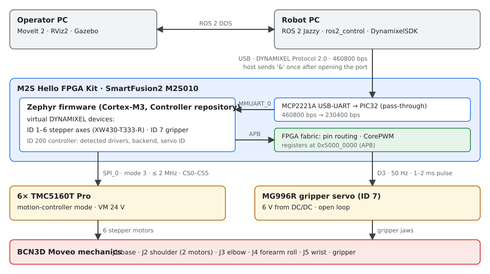

# SmartManipulator-X

SmartManipulator-X is a robot arm project. It combines the ROS 2 control
and operator-software concepts of ROBOTIS
[OpenMANIPULATOR-X](https://emanual.robotis.com/docs/en/platform/openmanipulator_x/overview/)
with the mechanical design of [BCN3D Moveo](https://github.com/BCN3D/BCN3D-Moveo).
Instead of DYNAMIXEL actuators, a Microchip SmartFusion2 controller drives the
stepper motors of the Moveo joints and a hobby servo on the gripper, and
presents them to the ROS 2 host as virtual DYNAMIXEL devices over Protocol 2.0.
The ROBOTIS host software can then talk to the arm as if it were built from
DYNAMIXEL servos.

This documentation covers the whole system: the Robot PC, the controller
firmware and hardware, the shared DYNAMIXEL contract, the Operator PC, and the
mechanics.

## System components

| Component | Role | Platform |
| --- | --- | --- |
| Operator PC | Motion planning, visualization and simulation (MoveIt 2, RViz2, Gazebo) | ROS 2, DDS client of the Robot PC |
| Robot PC | Robot-side ROS 2 control: `ros2_control`, the ROBOTIS hardware interface and DynamixelSDK; owns the USB link to the controller | Ubuntu 24.04, ROS 2 Jazzy in Docker |
| Controller firmware | DYNAMIXEL Protocol 2.0 device: six stepper axes (IDs 1–6), the gripper servo (ID 7) and a controller device (ID 200) | Zephyr RTOS on the SmartFusion2 Cortex-M3 (M2S Hello FPGA Kit, M2S010) |
| FPGA design | Pin routing of SPI and UART, CorePWM for the gripper servo | SmartFusion2 FPGA fabric (Libero) |
| Drives | Six BIGTREETECH TMC5160T Pro modules in motion-controller mode, MG996R gripper servo | 24 V and 6 V supplies |
| Mechanics | Joints, links and printed parts | BCN3D Moveo |

## Repositories

| Repository | Content |
| --- | --- |
| [SmartManipulator-X-Robot-PC](https://github.com/AntonVynohradov/SmartManipulator-X-Robot-PC) | Robot PC Docker image and ROS 2 workspace, diagnostics and USB tools, and this documentation site |
| [SmartManipulator-X-Controller](https://github.com/AntonVynohradov/SmartManipulator-X-Controller) | Zephyr firmware for the SmartFusion2 and the host-side DYNAMIXEL motor tester GUI |
| SmartManipulator-X-Libero | FPGA design and the hardware contract for the firmware (`docs/firmware_interface.md`) |
| Operator PC | Separate repository for planning, visualization and simulation |

## Documentation map

| Section | Pages |
| --- | --- |
| **Guides** | [Getting started](getting-started.md): from a fresh clone to a built firmware image and a running motor tester. [Development environment](development/index.md): Docker, Dev Container, west, VS Code tasks, Python `.venv`, tests, troubleshooting. |
| **Firmware** | [Firmware architecture](firmware/index.md): source layout, start-up order, threads, queues, data flow, configuration. [Motor tester GUI](gui/index.md): testing every axis and the gripper over DYNAMIXEL Protocol 2.0. |
| **Hardware** | [Hello FPGA Kit wiring](hardware/wiring.md): wiring of the kit, the six TMC5160 modules, the servo and power. [TMC5160 driver modules](hardware/tmc5160.md): pinout, motor connection, firmware interface review, bring-up checklist. [Gripper servo (MG996R)](hardware/servo.md): supply, signal, bring-up and calibration. |
| **System context** | [System architecture](architecture/index.md): component boundaries, control path, ARM/FPGA partition, verified state. [DYNAMIXEL compatibility](dynamixel/compatibility-spec.md): shared host/device contract. [Robot PC](robot-pc/index.md): ROS 2 control, Docker, USB device. [Operator PC](operator-pc/index.md): planning, simulation, DDS. [BCN3D Moveo mechanics](mechanical/index.md): the mechanical source. |

The whole documentation is also available as one PDF manual (the **PDF**
button in the header of the website).

## Current status

- **Controller firmware:** builds in two variants, the **target** variant
  (TMC5160 over SPI) and the **simulation** variant (simulated axes on the real
  board, for protocol tests). Both implement a functional subset of a virtual
  XW430-T333-R (PING, READ, WRITE, REG_WRITE, ACTION, SYNC_READ, SYNC_WRITE).
  The simulation firmware passes the automated conformance check
  (`firmware_check.py`, 49/49, including the gripper servo) when it runs as
  `native_sim` on a PC.
- **Hardware (2026-10-11):** the host link (460800 bps PC ↔ PIC32,
  230400 bps PIC32 ↔ SmartFusion2) works on the kit. On axis A0 (BTT
  TMC5160T Pro, 17HS19-2504S) SPI detection, the register mapping, telemetry,
  Current Limit and the ramp generator are verified, but **the shaft does not
  turn yet**: the module reads `SD_MODE=1` (STEP/DIR mode) instead of the
  motion-controller mode, see finding 10 in
  [Firmware interface review](hardware/tmc5160.md#findings). Motor currents,
  ramps and the motor-to-axis assignment are described in
  [Motor profiles and axis assignment](hardware/tmc5160.md#motor-profiles-and-axis-assignment).
- **Gripper servo:** a virtual DYNAMIXEL device on ID 7 driven by CorePWM in
  the FPGA fabric. On the kit it follows Goal Position; its travel is not
  calibrated yet.
- **Robot PC:** ROS 2 Jazzy Docker image with the selected ROBOTIS packages,
  and skeletons of the project packages (description, bringup, config). The
  upstream Jazzy sources still have to be verified against the device
  behavior (model numbers, registers), and the BCN3D Moveo robot model (URDF,
  meshes) is still to be created.
- **Open items for the whole arm:** joint-to-motor mapping and gear ratios on
  the real arm, shoulder pairing (IDs 2 and 3), joint limits, and safety
  (emergency stop). The [verified state versus target](architecture/index.md#verified-state-versus-target)
  table tracks them.
